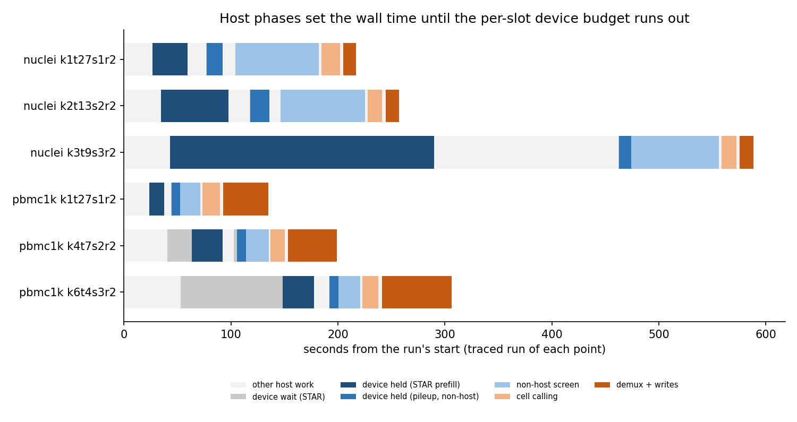
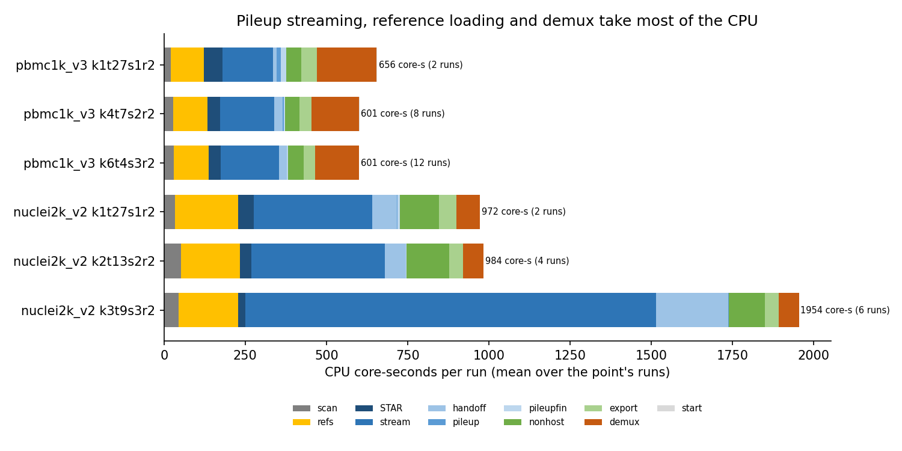

# GPU path profile: where a run's time goes

This profile covers gpu/frontier 99105bd8 (multi-arch build) on one pinned H100 NVL of node g052, 27 cores and 340 GB, at 1, 2 and 3 device slots. It uses two samples: pbmc1k_v3 (66.6 M read pairs) and the deeper nuclei2k_v2 (118.8 M read pairs, GRCm39). The measurements come from pilot items 15 and 16 (job 803869). Each point ran two runs per in-flight process. Run 0 of each point ran under nsys (`--trace=cuda,nvtx --trace-fork-before-exec=true --cuda-memory-usage=true`) with NVTX ranges and the transfer ledger on. The harness recorded wall time, cgroup CPU per stage, device lock wait and hold, and host and device peaks. The alignment kernels' times come from the kernel replay harness (job 803599, `bench/gpu/replay`).

## Throughput by slot count

| sample | point (in flight, threads, slots) | steady rate, M pairs/s | wall s, mean | core-s per M pairs | device wait / held per run, s | GPU util % | host peak GB |
|---|---|---|---|---|---|---|---|
| pbmc1k_v3 | 1, 27, 1 | 0.49 | 145 | 10.3 | 1 / 25 | 9 | 53 |
| pbmc1k_v3 | 4, 7, 2 | 1.46 | 195 | 9.4 | 29 / 41 | 28 | 176 |
| pbmc1k_v3 | 6, 4, 3 | 1.87 | 248 | 9.4 | 35 / 55 | 38 | 235 |
| nuclei2k_v2 | 1, 27, 1 | 0.55 | 228 | 8.7 | 0 / 50 | 12 | 94 |
| nuclei2k_v2 | 2, 13, 2 | 0.96 | 260 | 8.7 | 1 / 84 | 22 | 178 |
| nuclei2k_v2 | 3, 9, 3 | 0.67 | 569 | 17.4 | 0 / 236 | 36 | 239 |

pbmc1k_v3 gains throughput with every added slot, although the gain shrinks. nuclei2k_v2 loses at 3 slots, because every run there fell back from level 5 (see below). Every other run in both items reached level 5 with the GPU pileup.

*Figure 1. The traced run of each point, from its NVTX ranges (`bench/gpu/profile/data`). Dark blue bars show the STAR child holding the device for its prefill. Mid blue shows the pipeline holding it for the hand-off, pileup and non-host screen. Grey marks waiting for a device slot.*

## Host phases set the wall time at one slot

At one slot a pbmc1k_v3 run holds the device for 25 s of its 135 s. The other 110 s are host work. About 24 s pass before STAR's prefill takes the device: the .1fq scan, the cell-barcode histogram and building the E8 records. After STAR completes, the non-host screen runs for 19 s, of which only 5 s is on the device. Cell calling takes 16 s and demux with the parallel writes 42 s. nuclei2k_v2 has the same shape, with one difference: its non-host screen takes 78 s, and only 7 s of that is on the device. More slots raise throughput precisely because these host phases of one run overlap the device phases of another.

*Figure 2. CPU core-seconds per run by stage (the harness's 1 s cgroup sampler), averaged over each point's runs.*

A pbmc1k_v3 run costs about 600 core-seconds. The three largest stages:

- Pileup streaming from STAR: about 165 core-s.
- Demux: about 140 core-s.
- Loading the pileup references: about 105 core-s.

The last stage repeats the same work in every run. Even at 6 in flight the cgroup used 15.6 of its 27 cores, so the host CPU is not saturated. What limits each run is its own serial phases.

## The alignment kernels

STAR runs in a child that the pipeline forks without exec, and the child exits through `_exit()`. nsys records the child's NVTX ranges but none of its kernels or copies, and `--cuda-flush-interval=100` changes nothing (RTX smoke 803900). The pipeline process's kernels are fully recorded: the GPU pileup and the non-host screen, 471 launches in 0.30 s of device time inside a 12.6 s window, so the device sits idle for 98% of that window. The largest of them, `k_binsum`, takes 50 ms.

The alignment kernels' times therefore come from replay. On the standard set of 1,991,926 distinct pbmc1k_v3 sequences, the frontier's lanes are byte-identical to STAR and take:

| lane | reads | ms | phase 1 (seeds) | SA scan | phase 3 (stitch) |
|---|---|---|---|---|---|
| A | 1,991,926 | 174 | 77 (seed kernel 56) | 14 | 82 |
| M | 524,577 | 213 | 61 | 17 | 134 (warp kernel 117) |
| B | 90,389 | 156 | 29 | 6 | 121 |

That comes to 3.67 M distinct reads per second. pbmc1k_v3 has 31.9 M distinct read sequences, so its lanes need about 8.7 s of kernel time. The traced one-slot run spent 10.2 s in "lanes of one chunk (GPU)", which puts the prefill's device phase close to its kernel bound at one slot. Phase 3 is the largest part of every lane, and lane B spends most of its time there.

## The prefill's device hold grows with slots

| traced run | slots | chunks | lanes on the GPU, s | prefill device hold, s | slot wait, s |
|---|---|---|---|---|---|
| pbmc1k_v3 | 1 | 2 | 10.2 | 14.0 | 0 |
| pbmc1k_v3 | 2 | 6 | 22.8 | 28.9 | 22.9 |
| pbmc1k_v3 | 3 | 13 | 19.0 | 29.2 | 95.3 |
| nuclei2k_v2 | 1 | 5 | 25.4 | 32.7 | 0 |
| nuclei2k_v2 | 2 | 20 | 52.6 | 63.3 | 0 |
| nuclei2k_v2 | 3 | 120 | 233.4 | 246.7 | 0 |

Two effects add up here. Concurrent holders share the SMs, so the same lanes take about twice as long while another slot's prefill runs. The per-slot E17 budget, (device − 2 GB)/slots, also shrinks, so each run maps more and smaller chunks, and every chunk adds fixed costs. For pbmc1k_v3 at 2 and 3 slots the first effect dominates. For nuclei2k_v2 at 3 slots the budget does the damage. The E8 records need about 36.1 GB of device memory, while a slot gets about 30 GB. In all six runs E17 stopped the records, so E10 and level 5 were off and STAR's loop did the per-read work. That run mapped 120 chunks, held the device for 247 s and doubled its CPU cost to 17.4 core-s per M pairs. This is E17 working as designed: a budget stop, which the prefill retry deliberately leaves alone. It still shows that a static share per slot caps the slot count for deep samples.

## Transfers

The prefill moves 32.3 GB host to device in 19.1 s of wall time. Almost all of it goes through one pinned, asynchronous site (`engine_gpu.cu:966`, 31.8 GB, 0.26 s of host time). The largest host cost in the ledger is 214 small pageable device-to-host copies at `engine_gpu.cu:694`: 0.12 GB that take 2.0 s of host time, because each copy waits for the kernels in flight. The hand-off moves 4.2 GB up and 2.2 GB down in 2.4 s. The pipeline process uploads 26.5 GB of the non-host index in every run (2.15 s of copies inside the 4.3 s "nonhost: context + index" range). That upload alone is a sixth of pbmc1k_v3's device hold at one slot.

## What this means for the Phase 3 cards

- **More slots.** The static per-slot budget is what limits it. A third slot helps pbmc1k_v3 (1.46 to 1.87 M pairs/s) but pushes nuclei2k_v2 out of level 5. The card needs admission by each run's estimated need, together with the shared index (IDEAS item 4, identical at 2 and 3 slots), which takes the genome index out of every slot's budget.
- **Cross-sample cache.** The advisor's option is an exact read cache: alignments of read sequences seen in earlier samples, which shortens the prefill's lanes. The profile adds two costs that repeat in every run and are identical for every sample on a genome: the 26.5 GB non-host index upload (4.3 s of device hold) and the pileup reference load (105 core-s for pbmc1k_v3, about 190 for nuclei2k_v2). Keeping both resident is the cheaper half of the card.
- **E3 hand-off bypass.** Levels 4 and 5 already keep every read with a device record out of STAR's per-read loop, which is what the advisor's bypass proposed. What remains is the host work inside STAR's window (the "stream" stage, about 165 core-s of a pbmc1k_v3 run), and that work has to be placed by thread before the card can name a change. nsys cannot sample CPUs on Clipper (`perf_event_paranoid` 4), so this takes a per-thread /proc sampler.
- **E2 truth-gated pruning.** It acts on the prefill lanes, about 10 s of a 25 s hold for pbmc1k_v3 at one slot, where phase 3 is the largest part and lanes M and B carry the heavy reads. Replay is the first tier.
- **Host work.** Demux with its writes (42 s), the non-host screen's host part (14 s for pbmc1k_v3, 71 s for nuclei2k_v2) and cell calling (16 s) set most of the wall time once the device phases overlap. They are CPU work outside this campaign's kernels, but they bound what any GPU change can buy.

## Reproducing

The items are `bench/gpu/pilot` items of the form `SAMPLE=... POINTS="k1t27s1r2@trace k4t7s2r2@trace k6t4s3r2@trace" NSYS_ITEMS=0 NSYS_TRACE=cuda+nvtx NSYS_EXTRA="--trace-fork-before-exec=true --cuda-memory-usage=true" SINGLET_NVTX=1`, run through `tp_gc.sbatch`. `bench/gpu/profile/nvtx_phases.py` turns each trace's sqlite export into the phase tables in `bench/gpu/profile/data`, and `bench/gpu/profile/profile_figs.py` draws the two figures from those tables and the pilot item logs.
