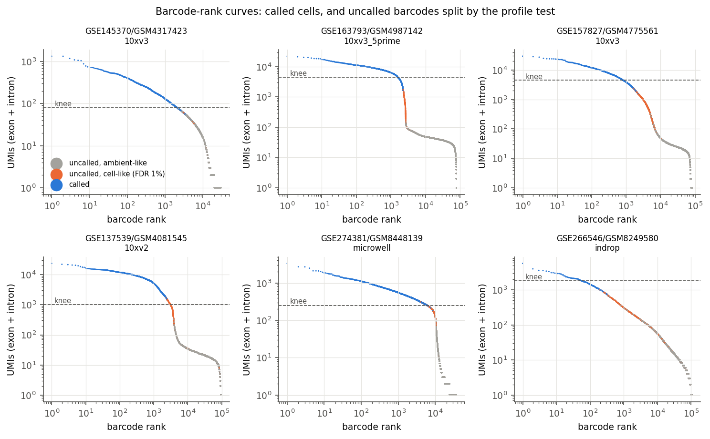
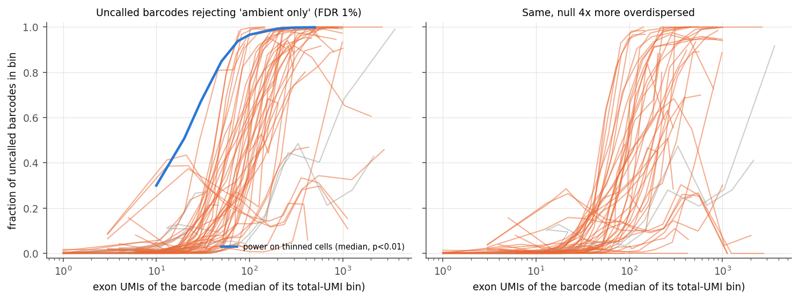
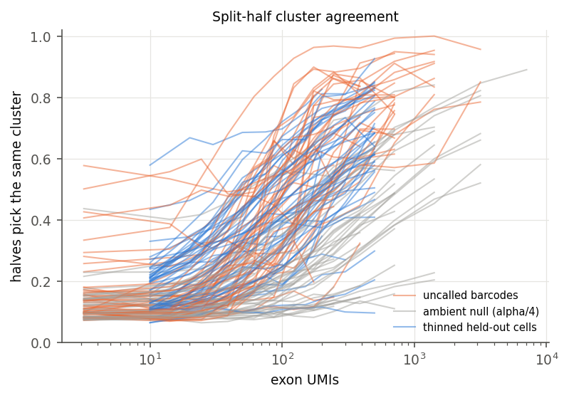
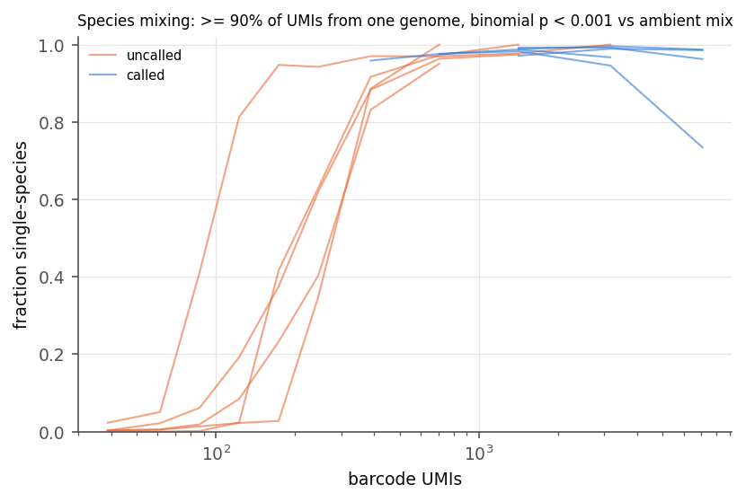
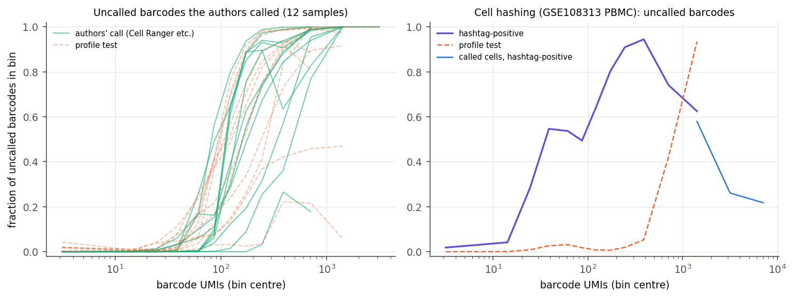
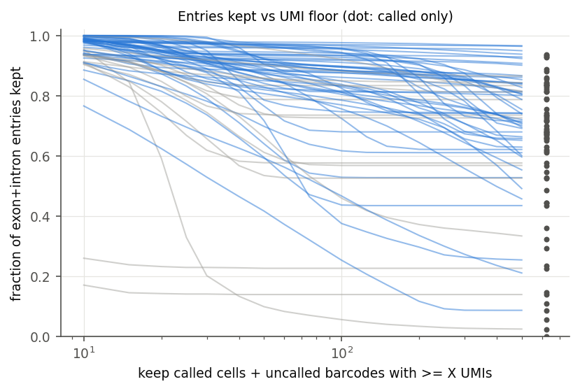
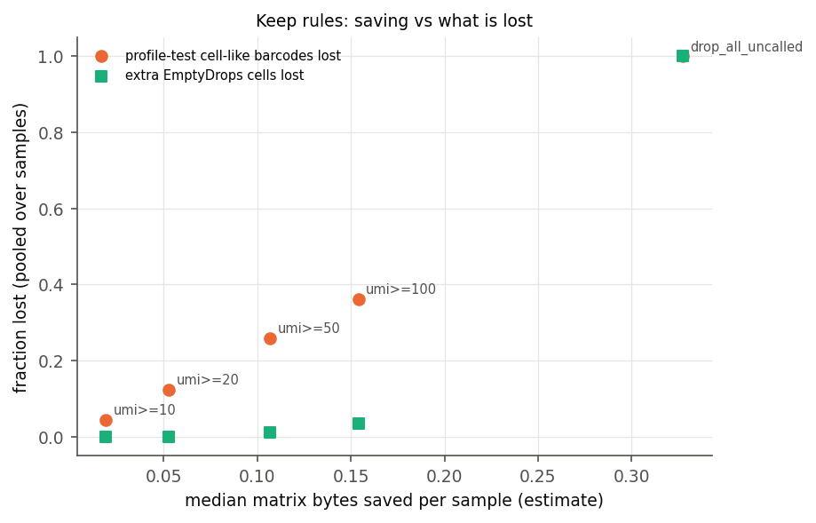

# Are Singlet's uncalled barcodes empty droplets?

Study for the v2 decision "may v2 drop the matrix entries of uncalled barcodes?" (2026-10-23). Code: `bench/empty_droplets/`.
Data: 65 samples of 18 studies read from the legacy `.singlet` bundles, 49 of them usable as gene-expression libraries (the rest
are hashtag/antibody/guide or TCR libraries processed as RNA, or Parse sub-libraries with a broken call; see "Samples").

## Verdict

**No. The uncalled barcodes are not demonstrably empty, and v2 should not drop them.** In 47 of 49 usable samples, between
hundreds and ~18,000 uncalled barcodes per sample (median 3,317, i.e. 57% as many as the called cells) carry RNA from single cells:

* their expression rejects "ambient RNA only" at FDR 1% against a depth-matched, overdispersion-aware null, and still does with
  a null four times more overdispersed (252k of 3.52M uncalled barcodes; 183k under the 4x null);
* split halves of each barcode's counts independently pick the same cell type, far above what any ambient draw does;
* in species-mixing samples they are single-species (83-97% of uncalled barcodes above 300 UMIs; 350-1,112 hidden single cells
  per sample) while the ambient plateau never is;
* their intronic and mitochondrial fractions are those of the called cells (median 0.27 and 0.017), not those of the ambient pool
  (0.10 and 0.000), although the test never looked at introns;
* they are enriched up to 10-60x in specific low-RNA cell types (microglia-like and oligodendrocyte clusters in brain nuclei,
  plasma cells, neutrophils, cytotoxic T cells);
* the authors' own calls (Cell Ranger filtered matrices deposited in GEO) include them: in all 11 gene-expression samples with a
  deposited call the authors called 643-14,048 more cells than Singlet (1.1-6.7x), while 0-64 of Singlet's cells (0-2.3%) are
  missing from the authors' sets; in human brain nuclei (GSE157827) 3.2-4.6x more nuclei;
* cell hashing marks them as stained cells: in the hashed PBMC library GSE108313, 14,920 uncalled barcodes carry a single
  dominant hashtag at >= 5x the empty-droplet level, against 2,950 called cells (71-82% of uncalled barcodes at 150-500 UMIs);
* every standard caller run on the stored matrix calls more cells than Singlet: EmptyDrops a median 1,911 more per sample
  (range 389-10,972), Cell Ranger 3-style a median 808 more, and 77-92% of those extra calls are cell-like by the profile test.

Only the lowest-UMI barcodes look empty by every test (profile, species, hashtags, the authors' calls), and they hold few
entries: everything below 20 UMIs is a median **5% of the matrix bytes** (p10-p90 2-13%), not the 33% (p10-p90 12-64%) that
"drop uncalled" would save. The safe rule and its saving are in "Recommendation".

Two facts change the framing of the question:

1. **`called` is not EmptyDrops.** No pipeline code passes `--soloCellFilter`, so STARsolo applies its default
   `CellRanger2.2 3000 0.99 10`: a single UMI threshold at one tenth of the 99th percentile of the top 3,000 barcodes, on STAR's
   own counts (`export.h` takes `Solo.out/Gene/filtered/barcodes.tsv` whenever it exists; the pipeline's own EmptyDrops runs only
   for protocols without Solo.out). That rule is known to miss cells with little RNA, and it is what the data show: a single
   threshold on the stored totals reproduces the call to within 0-5% of barcodes in every sample (median 0.6%).
2. **The v2 pilot GSE145370 is the wrong library type.** Its 14 samples (GSM4317423-36) are TCR-enriched V(D)J libraries
   ("S133_TCR Sample 1" ... in GEO); the mRNA libraries are GSM4317409-22 and are not in the bundle. The pilot's shallow counts,
   TRBV/TRAV cluster markers and large vdj member follow from that. Measurements on the pilot (29.9 MB -> 13 MB; 39-56% of
   entries in uncalled barcodes) describe amplicon libraries. Over the 49 usable gene-expression samples uncalled barcodes hold a
   median 32% of exon+intron entries (p10-p90 11-63%) and 33% of the estimated matrix bytes.

## What the stored barcodes are

* Matrix columns are the barcodes with >= 100 raw reads in the `.1fq` barcode dictionary (`src/pipeline/singlet.cpp`, barcode
  auto-discovery), not the whitelist and not the cells. In pileup counts many of them hold 0-2 UMIs (median uncalled barcode:
  8 UMIs in the PBMC sample, 1 in the pilot).
* `called` comes from STAR's call on STAR's counts; the stored counts are the pileup's. The two agree on rank: the best single
  threshold on stored totals mismatches 0-5% of barcodes (median 0.6%).
* The pileup sometimes counts one molecule once in the exon and once in the intron matrix: among uncalled barcodes with exactly
  2 UMIs, the two sit on one gene in a median 8% of cases (up to 70% in BD Rhapsody, 30-54% in the pilot), and in about half
  of those as 1 exon + 1 intron count. This inflates apparent overdispersion at low depth, so every expression test here uses
  exon counts only.
* The pipeline caps input at 30M reads per sample (`input_reads_capped`), so "deep" samples are subsampled; depth differences
  between studies are mostly protocol and library complexity.

## Samples

| study | protocol | reference | usable/fetched | called (median) | called UMI q05 | uncalled share of entries | cell-like uncalled (median) | EmptyDrops extra | CR3-like extra |
|---|---|---|---|---|---|---|---|---|---|
| GSE108313 cell hashing | 10x v2 | GRCh38 | 1/4 | 2950 | 2070 | 0.31 | 691 | 3874 | 665 |
| GSE137539 neutrophils | 10x v2 | barnyard (mouse only) | 3/3 | 5022 | 1142 | 0.17 | 2185 | 1453 | 1266 |
| GSE145370 pilot (TCR libs) | 10x 5' | GRCh38 | 7/14 | 2473 | 60 | 0.36 | 394 | 1002 | 517 |
| GSE157827 brain nuclei | 10x v3 | GRCh38 | 3/3 | 1936 | 1242 | 0.46 | 11821 | 10024 | 3026 |
| GSE163793 human+mouse lines | 10x v2/v3/5' + Drop-seq | barnyard | 4/5 | 3596 | 1839 | 0.15 | 4050 | 1208 | 400 |
| GSE179165 mouse gut immune | 10x v2 | GRCm39 | 2/2 | 2986 | 499 | 0.44 | 7174 | 5986 | 1158 |
| GSE180113 macrophages | 10x v3 | GRCh38 | 1/1 | 11074 | 720 | 0.21 | 6677 | 6018 | 1197 |
| GSE213957 HEK + 3T3 (CaRPool) | 10x v3 | barnyard | 4/4 | 9938 | 560 | 0.09 | 1102 | 749 | 136 |
| GSE216584 liver | BD Rhapsody | GRCh38 | 3/3 | 3017 | 614 | 0.36 | 16032 | 1911 | 583 |
| GSE216784 schwannoma cells + nuclei | Multiome GEX | GRCh38 | 4/4 | 4242 | 878 | 0.24 | 3546 | 3476 | 1028 |
| GSE230451 mouse hippocampus nuclei | 10x v3 | GRCm39 | 2/2 | 5590 | 653 | 0.23 | 884 | 2057 | 582 |
| GSE230559 AML marrow/blood | 10x v3 | GRCh38 | 3/3 | 15376 | 460 | 0.32 | 11539 | 8518 | 2584 |
| GSE233574 organoids | Parse | GRCh38 | 0/3 | (1-101 called: broken call) | | | | | |
| GSE246624 PBMC multiplexing | 10x v3 | GRCh38 | 2/3 | 7910 | 916 | 0.09 | 398 | 694 | 330 |
| GSE256089 PBMC, hashed | 10x 5' | GRCh38 | 2/3 | 10977 | 570 | 0.31 | 7851 | 5196 | 2462 |
| GSE266546 gut biopsies | inDrop | GRCh38 | 3/3 | 374 | 639 | 0.84 | 7182 | 2547 | 1436 |
| GSE274381 PBMC | Seq-Well | GRCh38 | 3/3 | 5593 | 220 | 0.32 | 4271 | 3952 | 3675 |
| GSE292909 cell-line village | 10x v3 | GRCh38 | 2/2 | 14096 | 314 | 0.33 | 5758 | 6708 | 1101 |

"Usable" = at least 200 called barcodes with median >= 100 UMIs. Excluded: GSE108313 GSM2895283/84 and GSM3501447 (HTO/ADT
libraries), GSE256089 GSM8085473 (HTO library, 6 barcodes), GSE246624 GSM7873659 (144 called), GSE163793 GSM4987478 (Drop-seq,
168 called), GSE233574 (Parse: 1-101 called per sub-library), 7 pilot samples (median called < 100 UMIs). "Uncalled share" is the
mean of the exon and intron shares of feature-level non-zeros; "extra" = called by that caller and not by Singlet (medians over
the usable samples of the study).

## Evidence

*Figure 1. Barcode-rank curves (stored totals). Orange: uncalled barcodes whose exon profile rejects "ambient only" at FDR 1%.
They form the shoulder between the called cells and the ambient plateau in every protocol.*

### 1. Profile test against ambient (Figure 2)

For each sample: ambient profile = Good-Turing proportions of the summed exon counts of uncalled barcodes with at most
`clip(0.5 x q05(called), 2, 100)` exon UMIs (any cells hiding there make the test conservative); Dirichlet-multinomial
concentration by maximum likelihood over those barcodes (as EmptyDrops); cell profiles = Leiden clusters of the called cells
(scanpy defaults). Each barcode is fitted as `w q_k + (1 - w) a` over clusters k and a grid of w; the statistic is the log
likelihood ratio against pure ambient. Its null is simulated, per barcode depth, from Dirichlet-multinomial ambient draws pushed
through the same fit, so the p-values account for depth, overdispersion and the fitting itself; beyond the simulated range an
exponential tail fitted above the null's 90th percentile extrapolates (calibration on fresh nulls: 1.0% below 0.01, 0.08% below
0.001). BH within the uncalled barcodes.

Power: called cells thinned to fixed depths and scored against clusters built from the other half of the cells reject ambient
in 35% / 67% / 84% / 93% / 98% of cases at 10 / 20 / 30 / 50 / 100 exon UMIs (medians over samples). So a 30-100 UMI barcode
that the test leaves alone is ambient-like with good confidence; at 10-20 UMIs the test cannot tell.

Pooled over the 49 usable samples, fraction of uncalled barcodes rejecting ambient at FDR 1% (fitted null / 4x overdispersed null):

| total UMIs | barcodes | cell-like | cell-like, 4x null |
|---|---|---|---|
| < 10 | 1,520,876 | 0.7% | 0.5% |
| 10-20 | 912,944 | 2.2% | 1.2% |
| 20-30 | 377,967 | 4.2% | 2.5% |
| 30-50 | 300,676 | 6.0% | 3.6% |
| 50-75 | 104,625 | 13.9% | 8.9% |
| 75-100 | 47,591 | 23.3% | 15.9% |
| 100-150 | 58,868 | 33.4% | 23.8% |
| 150-200 | 42,742 | 48.9% | 36.5% |
| 200-300 | 59,138 | 68.1% | 52.0% |
| 300-500 | 56,263 | 81.0% | 63.4% |
| 500-1000 | 31,809 | 88.9% | 78.3% |
| 1000-2000 | 6,344 | 92.9% | 87.5% |

*Figure 2. Each line is a sample (gray: not usable). Blue: power of the same test on called cells thinned to that depth.*

The fitted cell fraction w of significant barcodes is 0.8-0.9 above ~200 UMIs: these are cells with some ambient, not ambient
with a trace of cell. Where the transition sits depends on the sample: in brain nuclei GSE157827 everything above ~150 UMIs is
cell-like (88-100%); in BD Rhapsody liver a minority of 10-30 UMI barcodes already is. In the hashed PBMC library GSE108313 the
test calls the uncalled plateau at 30-500 UMIs ambient (median w = 0.01, 1-5% significant), yet hashtags show most of that
plateau is stained PBMCs (section 3b): a cell type absent from the called cells is invisible to this test, so its numbers are
lower bounds.

### 2. Split-half consistency (Figure 3)

Each barcode's exon counts are split 50/50 at random and the best cluster is fitted to each half. Ambient, however overdispersed
around the ambient mean, agrees only at a chance rate that rises slowly with depth (measured on null draws with alpha/4). In brain
nuclei the uncalled barcodes agree 73-87% at 100-300 exon UMIs against 10-15% for the null; in the human/mouse lines 55-63% at
200-500 against 14-19%. Thinned held-out called cells agree less often at the same depth (brain: 31-51% at 100-200 exon
UMIs), because the hidden barcodes come mostly from a few very distinct clusters (section 5).

*Figure 3. Split-half agreement by exon depth, usable samples.*

### 3. Species mixing (Figure 4)

GSE163793 (Jurkat + TALL104 human, EL4 + IVA12 mouse, 1:1:1:1) and GSE213957 GSM6596913 (HEK293FT + NIH/3T3) are mapped to the
combined reference. A barcode is single-species if >= 90% of its UMIs come from one genome and a binomial test against the
ambient mix rejects (p < 0.001); counted only at >= 30 UMIs.

| sample | ambient human fraction | uncalled 30-75 UMIs single-species | uncalled >= 300 UMIs single-species | hidden single cells (>= 30 UMIs) | called |
|---|---|---|---|---|---|
| GSE163793/GSM4987142 (3' v2) | 0.07 | 0.0% | 350 / 359 | 383 | 2300 |
| GSE163793/GSM4987144 (5') | 0.10 | 2.3-5.0% | 587 / 600 | 913 | 3421 |
| GSE163793/GSM4987146 (3' v3) | 0.14 | 0.3-2.2% | 1112 / 1212 | 1838 | 3771 |
| GSE163793/GSM4987148 (3' v3) | 0.12 | 0.3-0.6% | 587 / 671 | 1284 | 7881 |
| GSE213957/GSM6596913 | 0.97 | 0.3-0.5% | 518 / 581 | 794 | 13527 |

*Figure 4. Species-mixing samples, from 30 UMIs.*

Of the barcodes the profile test calls cell-like, 42-65% are single-species; of those it leaves alone, under 0.5%. Two
independent tests agree barcode by barcode, and the species test needs no model of ambient expression.

### 3b. Cell hashing (Figure 6, right)

GSE108313 GSM2895282 (Stoeckius et al. 2018, PBMC from 8 donor batches, each stained with its own hashtag, super-loaded): the
authors deposited hashtag counts for 65,000 barcodes (GSM2895283), covering 61,739 of the 80,597 stored barcodes. Reference for
an empty droplet: the barcodes with < 10 RNA UMIs (median 203 hashtag counts). A barcode is hashtag-positive at >= 5x that
(1,015 counts) and a singlet when one hashtag carries >= 60%.

| uncalled, total UMIs | barcodes | hashtag-positive | single hashtag | median hashtag counts |
|---|---|---|---|---|
| < 10 | 44,352 | 1.8% | 1.8% | 203 |
| 10-20 | 11,884 | 4.2% | 4.1% | 222 |
| 20-30 | 808 | 28% | 27% | 437 |
| 30-100 | 3,578 | 49-55% | 47-52% | 1,002-1,209 |
| 100-150 | 5,940 | 65% | 63% | 1,287 |
| 150-200 | 4,975 | 81% | 78% | 1,621 |
| 200-300 | 3,534 | 91% | 82% | 2,375 |
| 300-500 | 1,906 | 95% | 71% | 3,132 |
| called (>= 1,000) | 2,950 | 25% | 23% | 233-1,374 |

14,920 uncalled barcodes are hashtag singlets: five times as many stained cells sit among the uncalled barcodes as among the
called ones. The called set is dominated by large, proliferating cells (cell-cycle and ACTA2/COL1A2 clusters) that carry little
hashtag, i.e. cells that were not stained with the donor hashtags; the PBMCs themselves (100-500 UMIs in the 30M-read pileup)
were dropped by the CellRanger2.2 threshold. The profile test does not see them (30% hashtag-positive among its cell-like
barcodes vs 27% among the rest): almost no PBMC type is among the called clusters it compares against, and the ambient pool
(<= 100 exon UMIs here) is itself mostly PBMC RNA. That is the test's blind spot made visible: its counts are lower bounds.

### 4. Intronic and mitochondrial fractions

Medians over the 49 samples of the per-sample medians:

| group | intronic fraction | mitochondrial fraction |
|---|---|---|
| called | 0.267 | 0.019 |
| uncalled, cell-like | 0.267 | 0.017 |
| uncalled, not cell-like | 0.103 | 0.000 |
| ambient pool | 0.102 | 0.000 |

In brain nuclei (GSE157827/GSM4775562): called 0.63, cell-like uncalled 0.61, ambient 0.20 intronic. The profile test only
saw exon counts, so the intronic fraction is an independent check: cell-like uncalled barcodes are nuclei/cells, the rest is
ambient-like.

### 5. Which cells are missed

The cell-like uncalled barcodes are not a random sample of the called cells. The most enriched cluster per sample (share of
cell-like uncalled vs share of called): brain nuclei RGS1+ cluster 48% vs 4% and an oligodendrocyte (PLP1, CLDN11) cluster
48% vs 5%; AML marrow cytotoxic T/NK (LCK, PRF1, CD160) 34% vs 4% and B cells (MS4A1, CXCR5) 29% vs 5%; neutrophil samples
Retnlg/Mmp8 (4.4x) and Il1b/Cxcl2 (3.6x) clusters; PBMC plasma cells (IGHA1, TNFRSF17) 19% vs 0.3%; human/mouse lines a mouse
B-lineage cluster 44% vs 5%; schwannoma T cells 21% vs 3%. Low-RNA cell types are what a UMI threshold drops, so dropping their
barcodes would bias every composition estimate made from v2.

Some cell-like barcodes are damaged cells or fragments (one brain sample's enriched cluster is mitochondrial transcripts). They are
still not empty droplets, and deciding whether they are cells belongs to whoever re-calls.

### 6. Independent callers on the stored matrix

Medians over the 49 usable samples (EmptyDrops: our implementation of DropletUtils' algorithm, 10,000 Monte Carlo draws,
FDR 0.001, retain = knee; "adaptive" lower = clip(0.5 x q05(called), 5, 100)):

| caller | extra cells vs Singlet | Singlet cells it drops | Jaccard | extra calls that are profile-cell-like |
|---|---|---|---|---|
| EmptyDrops, lower = 100 | 1911 | 12 | 0.62 | 81% |
| EmptyDrops, adaptive lower | 1911 (389-10,972) | 8 | 0.64 | 79% |
| EmptyDrops, exon only | 1374 | 121 | 0.69 | 92% |
| Cell Ranger 3-like (OrdMag + EmptyDrops) | 808 (89-4,808) | 12 | 0.84 | 83% |
| OrdMag on stored counts (CellRanger2.2) | 470 | 67 | 0.85 | 77% |
| knee (barcodeRanks) | 30 | 794 | 0.70 | 89% |
| inflection | 719 | 1 | 0.64 | 82% |

No caller finds Singlet's call too generous except the knee, which sits above it. CellBender (section 9) adds 1,176-6,603
cells per sample where it runs.

### 7. Called barcodes that look empty

The same test applied to called cells (held-out clusters) finds 1.2% of called barcodes indistinguishable from ambient (p > 0.05),
mostly in the pilot's TCR libraries (6-27% of their called barcodes); median 0.3% per sample. One real exception: inDrop
GSE266546/GSM8249613, where 163 of 374 called barcodes (~300 UMIs) are ambient-like, i.e. that sample's call is mostly
ambient; GSE292909 has 1.4-1.7% (cells at ~300 UMIs). A minimum-UMI floor on called cells is not needed for storage (called
cells are kept anyway); a per-cell "ambient-like" flag would serve users better than a floor.

### 8. The authors' own calls (Figure 6, left)

*Figure 6. Left: share of uncalled barcodes in the authors' own call (green) and cell-like by the profile test (orange dashed),
non-pilot samples. Right: hashtag-positive fraction of uncalled barcodes (violet) and of called cells (blue) in GSE108313.*

Barcodes of the authors' filtered matrices (Cell Ranger's call in every case here), matched on the 16-mer:

| sample | authors | Singlet | both | authors only | Singlet only | authors-only lost if < 20 UMIs dropped |
|---|---|---|---|---|---|---|
| GSE157827/GSM4775561 (nuclei) | 6,243 | 1,936 | 1,936 | 4,307 | 0 | 0 |
| GSE157827/GSM4775562 | 15,357 | 3,305 | 3,305 | 12,052 | 0 | 0 |
| GSE157827/GSM4775563 | 6,166 | 1,532 | 1,497 | 4,669 | 35 | 0 |
| GSE180113/GSM5453390 | 18,461 | 11,074 | 11,074 | 7,387 | 0 | 0 |
| GSE230559/GSM7226732 | 26,419 | 15,470 | 15,426 | 10,993 | 44 | 36 |
| GSE230559/GSM7226733 | 24,585 | 15,376 | 15,319 | 9,266 | 57 | 22 |
| GSE230559/GSM7226734 | 16,530 | 2,483 | 2,482 | 14,048 | 1 | 24 |
| GSE246624/GSM7873657 | 8,516 | 7,892 | 7,873 | 643 | 19 | 0 |
| GSE246624/GSM7873658 | 8,690 | 7,929 | 7,926 | 764 | 3 | 0 |
| GSE256089/GSM8085472 | 16,758 | 11,413 | 11,349 | 5,409 | 64 | 0 |
| GSE256089/GSM8085474 | 17,912 | 10,541 | 10,480 | 7,432 | 61 | 0 |

(GSE256089 lanes are paired with GSMs by order, which the matching itself confirms: 99.4% of Singlet's cells are in the paired
lane. GSE213957's deposited metadata lists only the 2,387 cells that passed the authors' QC, so it is not a call.)

Every authors' barcode is among the stored barcodes, the authors' sets contain Singlet's almost entirely, and the authors' extra
cells sit at a median 300-600 UMIs, above any floor considered here. The pilot's TCR libraries can be compared with the authors'
gene-expression call of the same GEM wells (10x 5' libraries share cell barcodes): 3,502-15,820 cells against Singlet's
1,207-4,289, with 97-99.9% of the authors' cells among the stored barcodes. In those amplicon libraries many cells have fewer
than 20 UMIs (non-T cells get few TCR reads), which is one more reason not to take rules from the pilot.

### 9. CellBender

CellBender 0.3.2 (`remove-background`, 150 epochs, GPU, expected cells = Singlet's count, a tail of >= 5-UMI barcodes left as
"surely empty") was run on 10 samples' stored barcodes. It is the one caller that does not work well from Singlet's data: it
expects the full raw barcode list and warns that this input is not one. On 5 samples it failed inside CellBender, also on a
retry with a lower empty-droplet training fraction and a smaller posterior batch (minibatch assertion "fewer than 4 cells", a
48 GB CUDA allocation in the posterior, a tensor shape mismatch); one retry (GSE163793/GSM4987142) was still running at the time
of writing. The five that finished:

| sample | CellBender | Singlet | CellBender only (median UMIs) | Singlet only | Jaccard | profile-test cell-like barcodes CellBender calls |
|---|---|---|---|---|---|---|
| GSE145370/GSM4317423 (TCR library) | 4,464 | 2,722 | 1,743 (55) | 1 | 0.61 | 44% |
| GSE145370/GSM4317429 (TCR library) | 4,742 | 3,820 | 1,176 (28) | 254 | 0.71 | 63% |
| GSE163793/GSM4987146 (human + mouse lines) | 10,374 | 3,771 | 6,603 (93) | 0 | 0.36 | 60% |
| GSE213957/GSM6596913 (HEK + 3T3) | 16,336 | 13,527 | 2,809 (182) | 0 | 0.83 | 82% |
| GSE274381/GSM8448139 (Seq-Well PBMC) | 10,580 | 6,078 | 4,502 (197) | 0 | 0.57 | 98% |

CellBender agrees in direction with every other caller: it keeps all of Singlet's cells in the gene-expression samples and adds
1,176-6,603 more, mostly the barcodes the profile test calls cell-like.

## Recommendation

**Keep the matrix entries of every stored barcode in v2.** The cell call can be redone from stored data only if the uncalled
barcodes that hold cells keep their profiles. Those barcodes start anywhere from ~20 to a few hundred UMIs depending on the
sample, and in the hashed PBMC library they include the very plateau that looks ambient. No fixed rule drops much without
dropping cells.

If storage must shrink, the only rule this study supports is:

> keep the called barcodes and every uncalled barcode with >= 20 total (exon + intron) UMIs; for the dropped barcodes keep
> their per-barcode totals (already in the `cells` table: `n_umi_exon`, `n_umi_intron`, `n_feat_*`) and one summed profile per
> sample (exon and intron counts per feature over the dropped barcodes), plus the EmptyDrops concentration alpha estimated on
> the full data at the default lower bound.

*Figure 5. Share of exon+intron entries kept under "called + uncalled with >= X UMIs" (dots: called only).*

*Figure 7. Candidate rules: median bytes saved against pooled losses.*

What it saves and loses (49 usable samples; bytes estimated as member bytes x share of that member's non-zeros kept):

| rule | matrix bytes saved, median (p10-p90) | cell-like uncalled lost, pooled (median per sample) | extra EmptyDrops cells lost | single-species hidden cells lost | authors' extra cells lost |
|---|---|---|---|---|---|
| drop all uncalled | 33% (12-64%) | 100% | 100% | 100% (5,212) | 100% (77,000) |
| keep >= 100 UMIs | 15% (5-39%) | 36% (18%) | 3.3% | 5.6% | 5.2% |
| keep >= 50 UMIs | 11% (4-28%) | 26% (9%) | 1.1% | 0.9% | n/a |
| **keep >= 20 UMIs** | **5% (2-13%)** | **12% (2.8%)** | **0.002%** | **0%** | **0.1% (82 of 77,000)** |
| keep >= 10 UMIs | 2% (0.2-8%) | 4% (1.9%) | 0% | 0% | 0.003% |

(Authors' extra cells: the 11 non-pilot samples above. Under keep >= 20 the hashed PBMC library loses ~300 hashtag singlets
(2% of 14,920): the singlet rate at 10-20 UMIs is 4.1% against 1.8% below 10.)

The pooled loss at >= 20 comes mostly from BD Rhapsody and inDrop, where a minority of 10-30 UMI barcodes is cell-like; at
10-20 UMIs the test has 35-67% power, so these barcodes are neither demonstrably empty nor demonstrably cells.

What survives under that rule:

* EmptyDrops re-calling: its inputs are the summed ambient profile (stored), alpha (stored scalar), the profiles of barcodes
  above `lower` (kept, since any sensible lower is >= 20) and every barcode's total (cells table). With alpha re-estimated from
  the remaining ambient barcodes instead of stored, re-calls agree with the full data to within 1% in 26 and within 3% in 36
  of 49 samples; the larger differences (PBMC GSE108313 67%, the pilot's TCR libraries 16-42%, Seq-Well 4-9%, mouse nuclei
  3-9%) come only from alpha, since the tested barcodes and the ambient profile are identical. With the stored alpha the
  re-call is exact by construction. Alpha depends on the chosen `lower`; storing it for lower = 100 (and the adaptive lower)
  covers the defaults.
* SoupX: its soup profile is the summed counts of droplets in `soupRange` (default 0-100 UMIs), recoverable exactly from the
  stored sum plus the kept barcodes.
* Knee/OrdMag/Cell Ranger 2 calls and barcode-rank plots: need only totals (cells table).
* Lost: per-droplet profiles below 20 UMIs. CellBender models individual empty droplets and would have to be fed droplets
  simulated from the stored profile at the stored totals; DecontX, scDblFinder and clustering do not use them.

A cheaper way to the same goal than dropping: keep uncalled barcodes, but in their own chunk run (or member) after the called
cells, so a default read never fetches them; the cell-index session already proposes variable-width chunks. Storage then costs
33% more than "called only", reads cost nothing extra, and nothing is irreversible.

Follow-ups this study points to (not done here): fix the pilot (migrate the mRNA libraries GSM4317409-22, not the TCR ones);
record the STARsolo filter actually used and consider an EmptyDrops-based `called_v2` flag computed from the stored data; screen
the atlas for feature-barcode and V(D)J libraries processed as RNA.

## Limitations

* The profile test needs clusters of called cells; a cell type with no called representative is invisible to it, and when such
  cells fill the ambient pool they even look ambient. The hashed PBMC library shows this happening (14,920 hashtag-identified
  cells, mostly missed by the test). Its counts of cell-like barcodes are lower bounds.
* Barcodes below ~20 exon UMIs are not testable one by one; what is said about them is collective.
* Byte savings are estimated from non-zero shares; low-UMI barcodes are mostly 1-counts, which the codec stores cheaply, so the
  true saving of a floor is probably a little smaller than estimated.
* One reference implementation of EmptyDrops (ours) was used; it follows DropletUtils but was not cross-checked against the R
  package on these data.

## Reproduce

All runs on Clipper from this branch (`bench/empty_droplets/run.sbatch`): `MODE=all` over `studies.tsv` (fetch by HTTP range,
analyse), `MODE=groundtruth`, `MODE=rules`, `MODE=aggregate`; CellBender with `cellbender.sbatch`. Results under
`$WORK/state/emptydrop/`; the figures, `empty-droplets/samples.csv` (one row per sample) and `empty-droplets/rules.json`
(per-sample rule evaluation) come from `MODE=aggregate` and `MODE=rules`.
