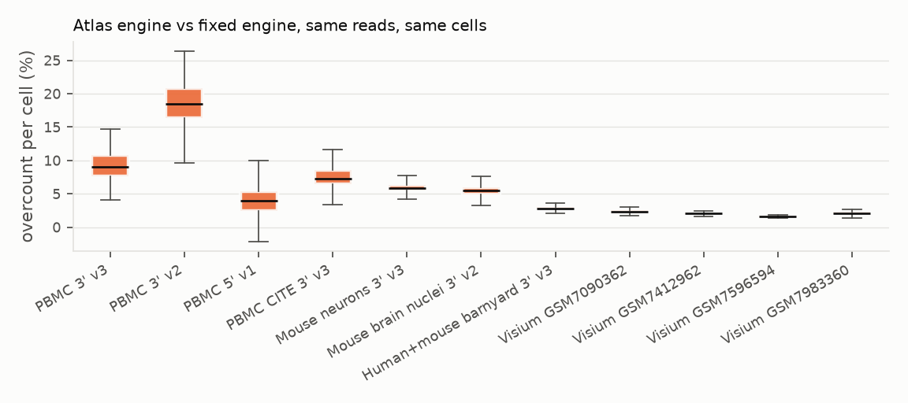
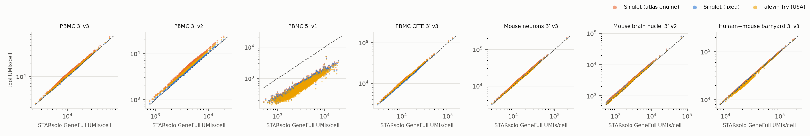
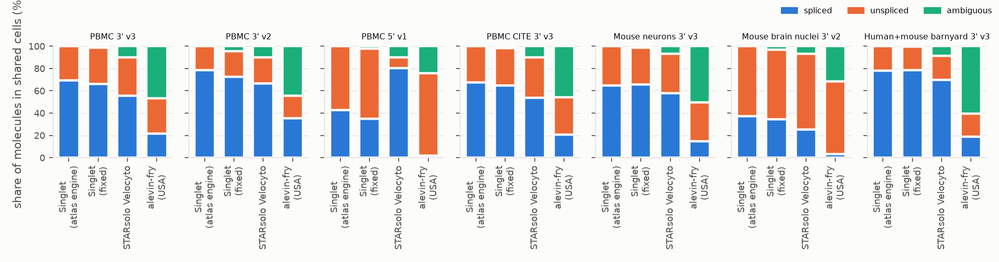

# Pipeline validation: molecule counting, the double count, and a benchmark against STARsolo, alevin-fry and Cell Ranger

Status: 2026-10-23, branch `fix/molecule-labels`. Written before the atlas-wide v2
campaign, at Zach's request, to check that Singlet's counts are fit to publish.

## Summary

- **The atlas overcounts.** Every published sample counts some molecules more than
  once. On the same reads and the same cells, the atlas engine's per-cell totals
  (exon + intron) are **+2% to +19%** above the fixed engine (median per dataset):
  - PBMC 3' v2: +18%;
  - PBMC 3' v3: +9%;
  - mouse neurons and nuclei: +6%;
  - Visium: +2%.

  For individual genes the excess reaches +33% to +75% at the 99th percentile. Two
  causes beyond the exon/intron overlap made it worse than the review expected (§1),
  and one of them makes the atlas counts depend on `--threads`.
- **The fix counts each (barcode, gene, UMI) once**, labelled spliced / unspliced /
  ambiguous with velocyto rules (§2). It is tested and gives identical matrices for 4
  and 16 pileup workers. Its runtime cost is not measurable.
- **After the fix, Singlet agrees with STARsolo and alevin-fry about as closely as those
  two agree with each other.**
  - Exonic counts vs STARsolo `Gene`: per-cell totals within −3% to +2%, per-cell gene
    correlation 0.96–0.99, pseudobulk ρ 0.95–0.99.
  - Exon + intron vs STARsolo `GeneFull`: +2% to +10%. alevin-fry USA is −3% to +18%
    on the same comparison.
  - Markers recomputed on the same cell labels overlap STARsolo's at Jaccard 0.89–0.93,
    the highest of any tool tested.
- **Where Singlet is worse:**
  1. **Strand detection is broken for 5' libraries.** The PBMC 5' run was counted almost
     entirely antisense (per-cell gene correlation with STARsolo 0.04). With
     `--reverse-strand` forced, the fixed engine matches STARsolo (0.99).
     **9,199 of 52,756 campaign samples (17%)** show the same signature, more than half
     of their reads on the wrong strand (§4.6). This is the most serious problem found
     and is separate from the double count.
  2. **Singlet calls fewer cells** than EmptyDrops_CR / Cell Ranger: 3–19% fewer in the
     cell datasets, Jaccard 0.82–0.99 with Cell Ranger; nuclei are the exception. Its
     calls track STARsolo's CellRanger 2.2 knee filter, in line with the empty-droplets
     review.
  3. **Slightly more cross-species UMIs** in barnyard singlets: 0.59% vs 0.45–0.51%.
  4. **alevin-fry is 4–9× faster and uses ~6× less memory.** Singlet costs about the
     same as STARsolo.
- **Re-running the atlas** from SRA costs about 111k core-hours, or 133k with 20%
  retries. That is 2–4 weeks on Clipper. On Anvil it is ~111–133k SU, but only with
  32 samples packed per whole node and the genome shared in memory. That is more than
  the 114k SU balance as of 2026-10-20 (§5). BAMs were not kept, so a re-pileup alone
  is not possible.

## 1. What was wrong in the atlas engine

The atlas was counted by `PileupEngine` (`include/singlet/pileup/pileup_engine.h`) as it
stood at 9e7c38e (the `Singlet-AI/singlet` build used by the GRCh38 campaign; its pileup
and UMI code is byte-identical to `main` at b1335a8, which is the "atlas engine" in every
table below). The campaign ran `singlet <file>.1fq --pipeline --threads 4`, which means
directional UMI collapse and the region-parallel pileup (`run_parallel`) with 4 workers.

Three separate mechanisms counted one molecule more than once. Each one inflates
`X = exon_counts + intron_counts`, which is what every Singlet client returns as
"counts".

1. **Exon and intron UMIs were deduplicated in separate sets.** A (barcode, gene, UMI)
   whose reads touched an exon and an intron of the gene was counted once in
   `exon_counts` and once in `intron_counts`. This includes the most common case, one
   read across an exon-intron boundary (it was counted in both matrices by itself).
2. **An exonic read of one gene that also lay in an intron of another gene** (nested or
   overlapping genes on the same strand) was counted for both genes: as exon for one and
   intron for the other.
3. **Multi-mappers split across pileup workers were deduplicated on their own.**
   `run_parallel` gives each worker whole chromosomes. A gene-unique multi-mapper whose
   alignments land on chromosomes owned by different workers is resolved after the
   workers finish, against a fresh UMI set, so its molecule was counted again whenever
   the same molecule also had reads inside a worker. How many reads take this path
   depends on how chromosomes are spread over workers, so **the atlas counts depend on
   `--threads`** (section 4.2). Cross-worker multi-mappers were also never counted as
   intronic.

Mechanism 3 was not in the original review; it turned out to be the largest of the three
for 10x 3' data.

## 2. The fix: every molecule counted once, labelled spliced / unspliced / ambiguous

Reads no longer go to two UMI sets. Every gene-assigned read joins one molecule record,
keyed by (barcode, gene, UMI), in a single store (`DirectionalUmiStore::record_read`).
The record keeps what each read touched. After all reads are in, UMIs are collapsed
(directional 1-Hamming as before, or exact) and each molecule is labelled **once**
(`finalize_molecules`).

**Read → gene (exon priority).** A read is assigned to the single gene whose exons it
overlaps (strand-aware, as before). Failing that, it goes to the single gene whose
introns it overlaps. Intron hits of *other* genes are ignored (fixes mechanism 2).
STARsolo's `GeneFull_Ex50pAS` makes the same choice. Reads overlapping exons of two
genes stay uncounted, as before.

**Read evidence** (collapsed gene model: exons = union of the gene's exons, introns =
gene body minus exons):

| read | evidence |
|---|---|
| all aligned bases in exons of the gene (spliced or not) | exonic |
| some aligned base in an intron of the gene (intronic, or across an exon-intron boundary) | intronic |

**Molecule label** — the velocyto / STARsolo `Velocyto` rule, applied to the evidence of
every read of the molecule, after UMI collapse (merged UMIs pool their evidence):

| reads of the molecule | label | written to |
|---|---|---|
| only exonic | spliced | `exon_counts` |
| only intronic | unspliced | `intron_counts` |
| both | ambiguous | `exon_counts` **and** `ambiguous_counts` (new, gene level) |

What this guarantees:

- `exon_counts + intron_counts` counts every molecule once. It equals STARsolo
  `GeneFull` in definition and needs no client change.
- `exon_counts` alone is spliced + ambiguous. That is the STARsolo `Gene` / Cell Ranger
  (exonic) definition, so cell calling, which uses exon counts, keeps its meaning.
- The velocyto layers are recoverable: spliced = gene(`exon_counts`) − `ambiguous_counts`,
  unspliced = gene(`intron_counts`). The h5ad and loom writers now emit
  `spliced` / `unspliced` / `ambiguous` layers that sum to `X`.
- Multi-mappers resolved across workers are routed into the store that already holds
  their (barcode, gene) before any store is finalized (fixes mechanism 3). The counts
  no longer depend on the number of workers (section 4.2).
- `pileup_stats.json` gains `molecules_spliced`, `molecules_unspliced`,
  `molecules_ambiguous`, `molecules_legacy_double` (molecules the old code put in both
  matrices) and `cross_gene_intron_reads`.

How this differs from the references. velocyto and STARsolo label against individual
transcripts. An exonic read that is also compatible with an intron-retaining isoform, or
that lies in an exon of one isoform and an intron of another, becomes *ambiguous* there.
With the collapsed gene model it is *spliced* here. So Singlet reports far fewer
ambiguous molecules than STARsolo `Velocyto` and correspondingly more spliced
(section 4.3). alevin-fry's USA mode is stricter still: any read compatible with both a
spliced and an unspliced target is ambiguous. The gene totals agree; only the S/A
boundary differs.

**Tests** (`tests/cpp/test_molecule_labels.cpp`, 58 checks, all passing on Clipper). The
store is tested directly, and a synthetic BAM goes through both `run()` and
`run_parallel()` (2 workers), each with directional and exact UMI collapse. The BAM
covers:

- a read across an exon-intron boundary → unspliced, counted once;
- exonic and intronic reads of one UMI → ambiguous, counted once;
- a spliced exon1→exon2 read → spliced;
- a read in an exon of a gene nested in another gene's intron → counted once, for the
  nested gene;
- 5 exonic reads of UMI X and 1 intronic read of X′ (one mismatch) → one ambiguous
  molecule with directional collapse, a spliced and an unspliced molecule with exact
  collapse;
- a gene-unique multi-mapper whose primary is intronic on chr1 and secondary intergenic
  on chr2 (a cross-worker read) → joins the exonic molecule of the same UMI as ambiguous;
- a multi-mapper over two genes → not counted.

The existing saturation, cell QC, EM-rescue, sparse-accumulator and read-stats tests
still pass.

## 3. Benchmark design

**Datasets.** Public 10x data with known structure, run from the same FASTQs and with
the same reference for every tool. That reference is Singlet's campaign build
(`cellarium/reference/{GRCh38-2024-A, GRCm39-2024-A, GRCh38-GRCm39-barnyard}`: 10x 2024-A
genomes and GENCODE v44 / M33 GTF, STAR 2.7.11b index).

| id | data | chemistry | why |
|---|---|---|---|
| pbmc1k_v3 | 10x PBMC 1k | 3' v3 | standard |
| pbmc1k_v2 | 10x PBMC 1k | 3' v2 | older chemistry, 10 bp UMI |
| pbmc5p_v1 | 10x PBMC (vdj_v1_hs_pbmc2), first 60M read pairs | 5' v1 | 5' chemistry |
| pbmc1k_cite_v3 | 10x PBMC 1k + TotalSeq-B | 3' v3 | protein (ADT) ground truth |
| neuron1k_v3 | 10x mouse E18 brain cells | 3' v3 | mouse |
| nuclei2k_v2 | 10x mouse brain nuclei | 3' v2 | single-nucleus, intron-rich |
| hgmm1k_v3 | 10x HEK293T + NIH3T3 1:1 | 3' v3 | barnyard: doublet and ambient truth |
| 4 Visium BAMs | GSM7090362, GSM7412962, GSM7596594, GSM7983360 | Visium | Singlet's own campaign BAMs, re-piled |

**Tools.**

- **Singlet, atlas engine** (b1335a8) and **fixed engine** (this branch). Both run with
  the campaign's flags (`--pipeline`, directional UMI collapse, parallel pileup) at 4
  workers as in the campaign. Both are also run at 16 workers.
- **STARsolo 2.7.11b** in Cell Ranger 4+ emulation:
  - `--soloFeatures Gene GeneFull Velocyto`, `--soloCellFilter EmptyDrops_CR`;
  - `--soloUMIdedup 1MM_CR`, `--soloUMIfiltering MultiGeneUMI_CR`;
  - `--soloCBmatchWLtype 1MM_multi_Nbase_pseudocounts`, `--clipAdapterType CellRanger4`,
    `--outFilterScoreMin 30`.
- **alevin-fry 0.18.3** through simpleaf 0.30, with a spliced+unspliced (USA) piscem
  index built from the same FASTA and GTF, `--resolution cr-like`, and the same 10x
  permit lists.
- **Cell Ranger:** the matrices 10x published with each dataset (Cell Ranger 2–3,
  exonic only, older reference). They are only a loose reference here. Running
  Cell Ranger 8 needs Zach to accept the 10x EULA; that is pending.

Every run used 16 threads and 96 GB on Clipper; runtime was measured with GNU
`time -v`. SMART-seq-like plate data was not run: it has no UMIs, so the double count
does not apply, and Singlet handles it on a separate code path.

**Metrics** (`bench/pipeline/analysis/compare.py`). Unless stated otherwise, everything
is computed on the cells called by both STARsolo (EmptyDrops_CR) and Singlet. Genes are
matched by Ensembl ID.

- per-cell total ratio and log correlation;
- median per-cell gene-vector correlation (log1p);
- pseudobulk Spearman ρ;
- spliced / unspliced / ambiguous shares;
- Jaccard overlap of called barcodes;
- Leiden clusters per tool (same parameters) and their ARI against STARsolo `GeneFull`;
- marker overlap: top-50 Wilcoxon markers for the *same* labels, Jaccard;
- for CITE-seq, ARI against clusters from CLR-normalised ADT counts;
- for the barnyard, species purity, mixed-species rate and cross-species UMI fraction.

Full tables: [pipeline-validation/tables.md](pipeline-validation/tables.md). Code and
job scripts: `bench/pipeline/`.

## 4. Results

### 4.1 Size of the double count in the atlas

Atlas engine vs fixed engine, same reads, same cells, 4 workers as in the campaign. The
Visium BAMs were re-piled with `--bam-file`, which uses the single-thread path, so they
show mechanisms 1–2 only.

| dataset | per-cell overcount, median (p10–p90) | exon / intron matrix old:new | same-gene exon+intron doubles (of molecules) | cross-worker multi-mapper molecules | gene overcount p99 |
|---|---|---|---|---|---|
| PBMC 3' v3 | 9.1% (6.8–11.8) | 1.12 / 1.03 | 2.2% | 10.5% | 51% |
| PBMC 3' v2 | 18.4% (14.3–22.9) | 1.21 / 1.12 | 4.6% | 17.0% | 75% |
| PBMC CITE 3' v3 | 7.3% (5.7–9.6) | 1.09 / 1.04 | 2.7% | 8.1% | 46% |
| Mouse neurons 3' v3 | 5.9% (5.0–6.7) | 1.03 / 1.11 | 2.1% | 2.7% | 51% |
| Mouse brain nuclei 3' v2 | 5.5% (4.2–6.5) | 1.05 / 1.06 | 3.9% | 1.1% | 64% |
| Barnyard 3' v3 | 2.8% (2.5–3.2) | 1.02 / 1.05 | 1.1% | 4.6% | 33% |
| PBMC 5' v1 (mis-stranded, §4.6) | 3.9% (1.1–6.9) | 1.21 / 0.94 | 9.3% | 4.8% | 63% |
| Visium (4 samples, single-thread path) | 1.6–2.3% | 1.00 / 1.29–1.92 | 0.6–1.4% | n/a | 9–15% |

How to read this:

- The overcount is not uniform across genes. Median genes move 1–3%, while the 1% most
  affected genes are inflated by a third to three quarters. These are mostly genes with
  many multi-mapping reads, or nested in or overlapping another gene.
- Per-cell overcounts are fairly tight (narrow p10–p90), so cell rankings barely change.
  Absolute values and gene-level comparisons across datasets do change.
- The intron matrix is the most distorted: up to 1.9× for Visium. There it is dominated
  by exonic reads of one gene counted in another gene's intron (mechanism 2).
- The cross-worker column is the atlas engine's own count of molecules it deduplicated
  outside the workers; most of them were counted twice.

### 4.2 Worker-count dependence

Same engine, same reads, 16 vs 4 pileup workers:

| dataset | atlas engine: entries that differ | atlas engine: total 16/4 | fixed engine: entries that differ |
|---|---|---|---|
| PBMC 3' v3 | 58,378 | 1.0008 | 0 |
| PBMC 3' v2 | 41,400 | 1.0091 | 0 |
| PBMC CITE 3' v3 | 33,663 | 1.0037 | 0 |
| Mouse neurons 3' v3 | 48,122 | 1.0017 | 0 |
| Mouse brain nuclei 3' v2 | 29,106 | 0.9993 | 0 |
| Barnyard 3' v3 | 32,129 | 0.9999 | 0 |

The atlas numbers depend on `--threads`, which is not a recorded scientific parameter.
The fixed engine is exactly reproducible across worker counts.

### 4.3 Count concordance with STARsolo and alevin-fry (fixed engine)

Per-cell total ratio (median over shared cells) / median per-cell gene correlation /
pseudobulk ρ:

| dataset | Singlet exon vs STARsolo `Gene` | Singlet exon+intron vs STARsolo `GeneFull` | atlas engine vs `GeneFull` | alevin-fry USA vs `GeneFull` |
|---|---|---|---|---|
| PBMC 3' v3 | 0.996 / 0.993 / 0.988 | 1.032 / 0.978 / 0.942 | 1.127 / 0.976 / 0.939 | 1.059 / 0.977 / 0.943 |
| PBMC 3' v2 | 1.018 / 0.988 / 0.980 | 1.081 / 0.959 / 0.932 | 1.279 / 0.960 / 0.933 | 1.176 / 0.965 / 0.936 |
| PBMC 5' v1 (`--reverse-strand`) | 0.990 / 0.994 / 0.992 | 1.025 / 0.987 / 0.959 | — | 1.046 / 0.984 / 0.954 (ori fw) |
| PBMC CITE 3' v3 | 0.991 / 0.994 / 0.991 | 1.020 / 0.983 / 0.948 | 1.095 / 0.979 / 0.943 | 1.071 / 0.978 / 0.946 |
| Mouse neurons 3' v3 | 0.981 / 0.989 / 0.963 | 1.041 / 0.980 / 0.840 | 1.102 / 0.971 / 0.831 | 1.032 / 0.969 / 0.841 |
| Mouse brain nuclei 3' v2 | 1.023 / 0.957 / 0.949 | 1.102 / 0.948 / 0.835 | 1.163 / 0.943 / 0.825 | 1.071 / 0.961 / 0.839 |
| Barnyard 3' v3 | 0.967 / 0.989 / 0.984 | 1.023 / 0.984 / 0.916 | 1.053 / 0.977 / 0.907 | 0.973 / 0.965 / 0.902 |

**Exonic counts.** After the fix, Singlet's exonic counts are interchangeable with
STARsolo `Gene` (and so with Cell Ranger's exonic definition).

**Exon + intron.** Singlet's totals sit 2–10% above STARsolo `GeneFull` and close to
alevin-fry:
- Most of the difference is intronic reads STARsolo drops. `GeneFull` refuses any read
  overlapping two genes' bodies, while Singlet assigns it to the gene whose exon it
  hits, or else to the single gene whose intron it hits.
- The gap is largest for nuclei (1.10) and 3' v2 (1.08). Those have the most intronic
  reads.
- The lower pseudobulk ρ for mouse (0.84 for all three tools) comes from genes that
  STARsolo `GeneFull` zeroes out. It is not specific to Singlet.

**Against the published Cell Ranger matrices** (exonic, older reference), Singlet's
exonic counts are within −10% to +5% per cell, with ρ 0.96–0.98. These matrices are
not a clean comparison: the reference differs, and for the 5' sample 10x used the full
448M reads.

### 4.4 Spliced / unspliced / ambiguous

**Unspliced fractions agree.** Singlet's unspliced share matches STARsolo `Velocyto`:
per-cell unspliced ratio 0.96–1.08 in the 3' datasets, ρ 0.87–0.96.

**The spliced / ambiguous boundary is where tools differ**, as §2 explains:

| tool | ambiguous share |
|---|---|
| Singlet | 0.2–4.4% |
| STARsolo | 6.6–10.2% |
| alevin-fry | 31–60% |

So Singlet's spliced counts are higher than both. For velocity, spliced + ambiguous
from Singlet is comparable to STARsolo's spliced + ambiguous. The atlas engine reported
no ambiguous class at all, and its spliced share was 1–9 points higher than the fixed
engine's.

### 4.5 Cell calls

| dataset | Singlet | STARsolo EmptyDrops_CR | CellRanger 2.2 knee (on STARsolo) | Cell Ranger, published | Jaccard Singlet vs Cell Ranger | Jaccard knee vs Cell Ranger |
|---|---|---|---|---|---|---|
| PBMC 3' v3 | 1136 | 1223 | 1152 | 1222 | 0.920 | 0.932 |
| PBMC 3' v2 | 983 | 1016 | 992 | 996 | 0.985 | 0.986 |
| PBMC CITE 3' v3 | 583 | 721 | 627 | 713 | 0.818 | 0.879 |
| Mouse neurons 3' v3 | 1102 | 1263 | 1135 | 1301 | 0.844 | 0.871 |
| Mouse brain nuclei 3' v2 | 2188 | 2151 | 2016 | — | — | — |
| Barnyard 3' v3 | 880 | 1041 | 900 | 1046 | 0.841 | 0.860 |

Singlet's calls behave like a knee filter: close to the CellRanger 2.2 knee, and 3–19%
below EmptyDrops_CR and Cell Ranger, which agree with each other (Jaccard 0.95–0.99).
The missing barcodes are low-UMI cells. This matches the empty-droplets review
(Singlet-Bio/singlet#17). The count fix does not change Singlet's calls (Jaccard 1.0
between engines), so cell calling needs its own fix.

### 4.6 5' libraries are counted antisense

Singlet encoded the 5' v1 library as `10x-3p-v2`; both have 26 bp R1. That alone would
be harmless: the engine auto-detects strand in two places. Both failed here, and 93% of
strand-informative reads were counted on the wrong strand:

1. **The parallel pre-probe** samples the 20,000 first reads of the busiest chromosome.
   This is often chrM, where genes sit on both strands, so the probe sees few
   wrong-strand reads and does not flip. It still sets `strand_flipped_`.
2. **The post-pileup safety net** re-runs reversed when >50% of reads are wrong-strand,
   but only if `!engine_ptr->strand_was_flipped()`. That flag means "the probe ran",
   not "the probe flipped", so the retry never fires.

The result is that per-cell gene correlation with STARsolo is 0.04 and totals are 19%
of STARsolo's. With `--reverse-strand` forced, the same fixed engine agrees with STARsolo
(table in §4.3).

**In the atlas.** In the 52,756 kept GRCh38 campaign results (`pileup_stats.json`),
`wrong_strand / (wrong_strand + exon_hits)` has a median of 5% for 10x v3. But:
- **9,199 samples exceed 50%** and 4,654 exceed 90%;
- only 83 of those had `reverse_strand` applied;
- by protocol label: 10x v2 3,959; 10x v3 2,319; CEL-seq2 717; MARS-seq2 530;
  Drop-seq 444; SPLiT-seq 288; others.

Most 10x ones are probably 5' libraries. Some plate protocols may be legitimately
antisense-heavy; that needs per-protocol checking. These samples' gene matrices are
mostly antisense and intronic noise. This needs its own fix and validation (section 6)
before the v2 campaign.

### 4.7 Downstream structure

Clustering ARI between any two tools is modest everywhere (0.4–0.87), including STARsolo
`Gene` vs `GeneFull` (0.27–0.77). Leiden at a fixed resolution amplifies small count
differences, so it says little on its own. Two more telling measures:

**Markers recomputed for the same cell labels**, top-50 Jaccard vs STARsolo `GeneFull`:

| tool | Jaccard |
|---|---|
| Singlet fixed | 0.89–0.93 |
| alevin-fry | 0.80–0.91 |
| Singlet atlas engine | 0.87–0.90 |
| STARsolo `Gene`, Cell Ranger (exonic only) | 0.45–0.60 |

Including introns changes markers far more than the choice of tool does.

**CITE-seq ground truth.** ARI of RNA clusters against ADT clusters:

| tool | ARI |
|---|---|
| Cell Ranger | 0.573 |
| STARsolo `Gene` | 0.572 |
| **Singlet fixed** | **0.559** |
| alevin-fry | 0.509 |
| Singlet atlas engine | 0.471 |
| STARsolo `GeneFull` | 0.440 |

This is one dataset, one resolution and one seed, so it shows Singlet is in the same
range as the others, not that it is better.

**Barnyard**, on each tool's called cells:

| tool | mixed-species barcodes | cross-species UMIs in single-species cells (median) |
|---|---|---|
| Singlet | 0.1% | 0.59% |
| STARsolo | 0.5–0.6% | 0.46–0.51% |
| Cell Ranger | 0.7% | 0.45% |

Singlet's lower mixed rate comes from calling fewer, higher-UMI barcodes, not from better
doublet handling. Its cross-species fraction is slightly higher than the references';
the cause (cross-mapping vs ambient handling) is not established here.

### 4.8 Runtime and memory

16 threads, same node class (Xeon Gold 6226/6230):

| dataset | Singlet (+ .1fq encode) | STARsolo | alevin-fry |
|---|---|---|---|
| PBMC 3' v3 | 9.4 + 2.6 min, 20 GB | 8.5 min, 19 GB | 1.9 min, 3.4 GB |
| PBMC 3' v2 | 9.6 + 2.4 min, 20 GB | 9.5 min, 19 GB | 2.0 min, 3.4 GB |
| Mouse neurons 3' v3 | 9.8 + 2.8 min, 29 GB | 8.0 min, 28 GB | 1.5 min, 2.7 GB |
| Mouse brain nuclei 3' v2 | 12.6 + 4.1 min, 29 GB | 10.6 min, 27 GB | 8.7 min, 2.6 GB |
| Barnyard 3' v3 | 9.4 + 2.3 min, 57 GB | 8.6 min, 56 GB | 1.7 min, 5.9 GB |

- Singlet costs about what STARsolo costs: STAR alignment dominates and the pileup is
  ~1% of wall time.
- alevin-fry is several times cheaper.
- The fixed engine has no measurable cost over the atlas engine. Pileup time was
  27 → 34 s on PBMC 3' v3, out of a 9-minute run.

## 5. Cost of re-running the atlas

From the 52,756 kept GRCh38 campaign results:
- median 33.5M reads per sample;
- 0.39 h mean wall time at 4 threads, so **1.56 core-hours per sample**;
- excluding SRA download and `.1fq` encode (encode adds 1.5–4 min per sample at 16
  threads).

BAMs were not kept (535 survive), so a fix-only re-pileup is not an option: every sample
must be realigned. Scaled to ~71,000 samples:

| scenario | compute | wall time / charge |
|---|---|---|
| Clipper, 200 cores sustained | 111k core-h (133k with 20% retries) | 23–28 days, free |
| Clipper, 400 cores sustained | same | 12–14 days, free |
| Anvil `wholenode`, 32 × 4-core samples per 128-core node, genome loaded once in `/dev/shm` | same | **~111k–133k SU** |
| Anvil `shared`, one sample per job with its own genome (17.7 GB RSS → charged ≈ 9.3 cores) | — | ~258k–310k SU |

Anvil's balance was 114,119 SU on 2026-10-20. A full re-run fits only with whole-node
packing and a shared genome, and would use essentially the whole allocation. The hpc
skill's mouse-campaign rule of thumb (1.2 SU per sample) would give ~85k SU, but these
human samples are deeper. Clipper is the realistic option: free, about 2–4 weeks
depending on the share of the cluster. SRA download throughput is not included and may
be the real bottleneck.

Fixing strand detection (§4.6) before re-running avoids a second campaign. 17% of the
samples need re-counting anyway.

## 6. Remaining problems (not fixed here)

1. **Strand auto-detection** (§4.6). Two fixes are needed:
   - make `strand_was_flipped()` report an applied flip, so the existing >50% safety net
     fires;
   - probe a gene-rich nuclear chromosome rather than the busiest one.

   Then re-check the 9,199 flagged samples, per protocol.
2. **Cell calling** (§4.5) should move to EmptyDrops_CR (STARsolo's or Singlet's own),
   as the empty-droplets review recommends.
3. **The 5' library is detected as 3' v2 at encode**, and 3' poly-A trimming is applied
   to it. Harmless for counting once the strand is right, but the protocol label in the
   bundle is wrong.
4. **Bundle schema.** The fixed engine adds `ambiguous_counts.1pz` (gene × cell). The v2
   packer and readers should carry it. Clients that sum exon + intron are already
   correct without it.

## 7. Reproducing

All jobs are in `bench/pipeline/` and run on Clipper:

| step | script |
|---|---|
| tool environment | `setup_env.sbatch` |
| build both binaries + unit tests | `build.sbatch` |
| data | `fetch.sbatch` (and `subsample.sbatch pbmc5p_v1 60000000`) |
| alevin-fry indices | `af_index.sbatch` |
| runs | `submit_runs.sh` → `run_tool.sbatch <dataset> <tool>` |
| campaign BAM re-piles | `rerun_bam.sbatch` |
| comparisons | `compare.sbatch <dataset> [--barnyard] [--cite]` |
| figures and tables | `report.sbatch` |
| campaign costs and strand scan | `campaign_costs.sbatch` |

Outputs live in `/mnt/projects/debruinz_project/debruinz/singlet/pipeline-benchmark/`.
