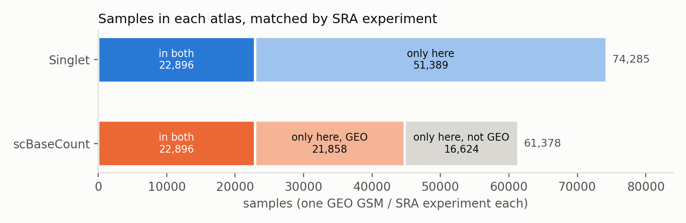
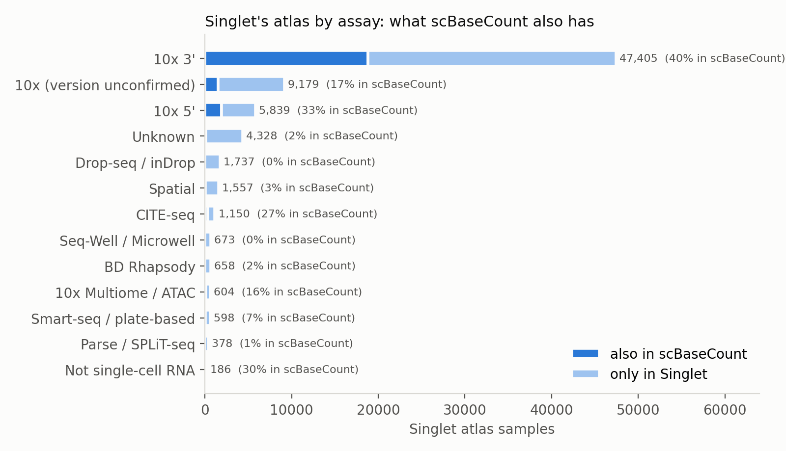
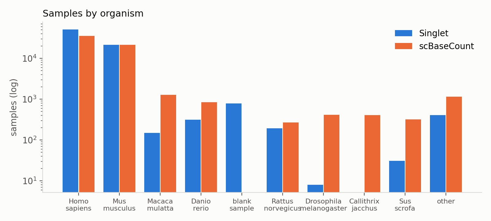
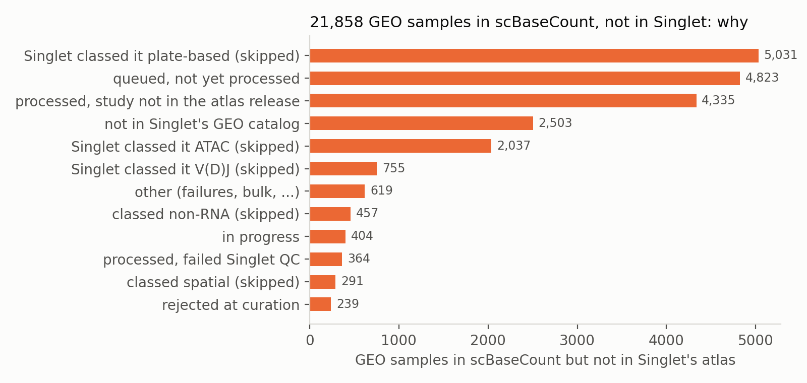
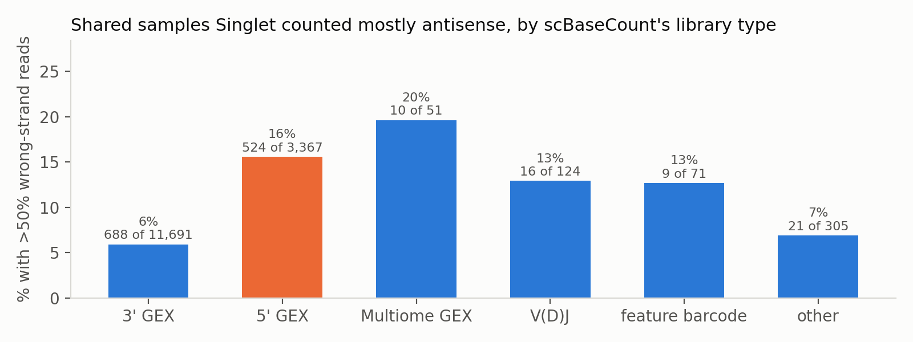
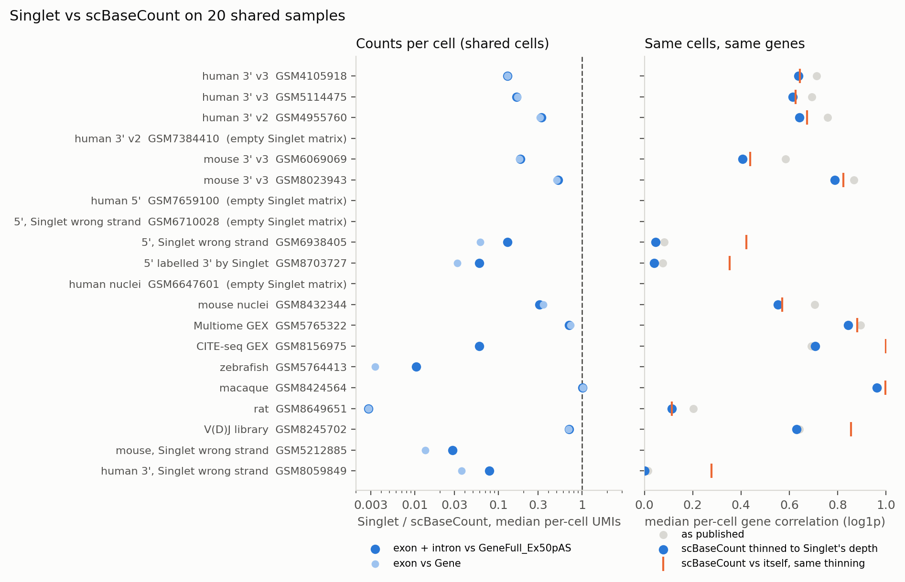
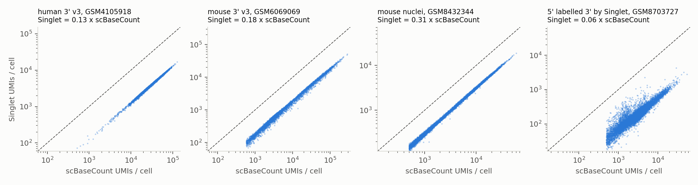
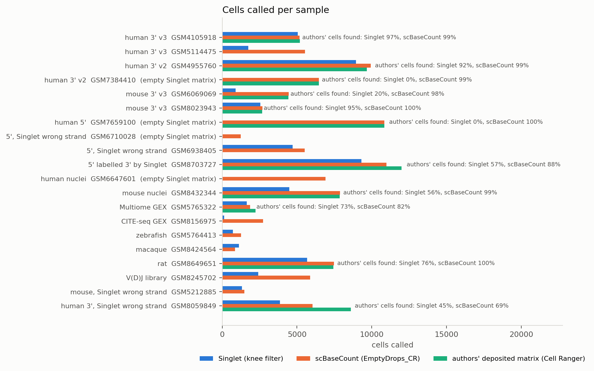
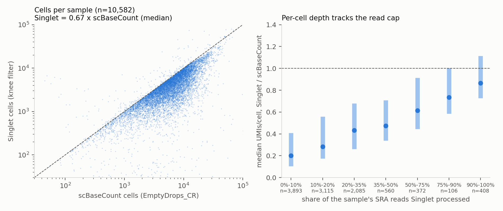

# Singlet vs scBaseCount (and Cell Ranger): coverage, processing and results on shared samples

Status: 2026-10-24, branch `bench/scbasecount`. Code and inputs: `bench/scbasecount/`. Figures and tables:
[scbasecount-comparison/](scbasecount-comparison/).

Purpose:
- (a) find comparisons Singlet can show honestly in marketing;
- (b) learn from scBaseCount where its pipeline or protocol is better.

Everything below was measured against:
- scBaseCount's public 2026-01-12 release (`gs://arc-institute-virtual-cell-atlas/scbasecount/2026-01-12`);
- Singlet's atlas as it is published today: legacy `.singlet` bundles and the singlet.bio catalog;
- the frozen v2 study list `plan-09fd92b149`.

Singlet's numbers here are the published atlas, not the fixed engine on PR #22.

## Summary

**Coverage.** The two atlases overlap less than either side expects.

| | Singlet | scBaseCount |
|---|---|---|
| samples | 74,292 | 61,378 SRX |
| studies | 8,010 | |
| samples from GEO | all | 44,754 |
| samples from ENA/SRA without GEO, plus CELLxGENE | — | 16,624 |

- **22,896 samples are in both** (matched by SRA experiment), across 3,089 Singlet studies.
- **Singlet only (51,389):**
  - 11,265 non-10x samples: Drop-seq, inDrop, Seq-Well, BD Rhapsody, Smart-seq, Parse, spatial and others. scBaseCount does not
    process these at all.
  - about 40,000 10x samples that scBaseCount has not reached. scBaseCount has processed 61k of its 111k targets.
- **scBaseCount only (38,482):**
  - 16,624 non-GEO samples (ENA/ArrayExpress/SRA-only, CELLxGENE);
  - 21,858 GEO samples. Singlet has queued 4,823 of them. It never processed 5,031 because its catalog classed them as
    plate-based, while scBaseCount finds valid 10x barcodes in them (median 6.4k cells). 4,335 were processed but sit in
    studies outside the atlas release.

**Cell calls and counts on shared samples.** Per sample, scBaseCount is closer to the authors' Cell Ranger results than Singlet
is today.
- scBaseCount's EmptyDrops_CR finds a median **99%** of the authors' cells (9 samples with a deposited matrix and a non-empty Singlet bundle).
- Singlet's knee filter finds a median **73%** (20–97%).
- On 10,582 clean shared human samples, Singlet calls **0.67×** scBaseCount's cells and has **0.32×** its UMIs per cell (§4).

**The main reason is read depth, not the counting engine.** The atlas campaign:
- truncated every sample to its **first SRR**;
- kept the **first 30M reads** of that SRR (`cellarium/full_campaign/run_one.sbatch`).

The median sample used **15% of its SRA reads**, and 82% used less than half. scBaseCount uses every read of every run.

When scBaseCount's counts are thinned to Singlet's per-cell depth, Singlet's per-cell gene profiles match them **as closely as
two independent thinnings of scBaseCount match each other**: median correlation 0.01–0.04 below that noise floor on every
correctly stranded sample. So the pileup engine is fine and the inputs were truncated.

This is a third atlas-wide problem, beside the double count and the strand bug, and it is **not in the known-issues list**.

**Known Singlet issues, checked against scBaseCount:**

| issue | scBaseCount |
|---|---|
| exon/intron double count | does not have it (STARsolo counts each UMI once) |
| 5' / wrong strand | handled better: strand is tested per sample on 1M reads |
| conservative cell calls | handled better: EmptyDrops_CR |
| non-GEX libraries processed as RNA | handled **worse**: its release includes 892 feature-barcoding, 694 V(D)J and 54 CellPlex SRX as gene-expression matrices, and no library-type screen is described |

Two things Singlet does that scBaseCount does not:
- a library-type screen;
- a per-protocol path for non-10x chemistries.

**Found in passing: 557 published studies (6,321 samples, 8.5%) have empty count matrices in their `.singlet` bundle**, although
the catalog lists them as done with cells. Four of the 20 samples picked at random for this comparison were among them. Eight
more were checked; all empty. List: `bench/scbasecount/empty_bundle_suspects.tsv`.

**What Singlet can claim today:**
- broader protocol coverage;
- more GEO samples;
- richer per-cell modalities;
- CC0 licensing;
- free, no-account downloads.

**What it cannot claim today:**
- better or deeper counts, or better cell calls, than scBaseCount or Cell Ranger.

Those claims become available after a full-depth re-run with the PR #22 fixes, the strand fix and EmptyDrops calls. On the same
reads, the fixed engine agrees with STARsolo (`docs/pipeline-validation.md`).

## 1. What scBaseCount is

| | scBaseCount (Arc Institute) |
|---|---|
| paper | Youngblut et al., *scBaseCount: an AI agent-curated, uniformly processed, and autonomously updated single cell data repository*, bioRxiv 2025.02.27.640494 (v3, 2025-11-02) |
| releases | 2025-02-25 (230M cells, 21 organisms, filtered only); **2026-01-12** (502M cells, 27 organisms, 75 tissues; 61,378 SRX in the metadata tables) |
| discovery | SRAgent: LLM agents query SRA/GEO (eSearch, eFetch, BigQuery) and classify each SRX: is it 10x, which chemistry, organism, tissue, disease, cell vs nucleus |
| scope | **10x Genomics only**. Barcode sets tested: 3' v2, 3' v3, 5', Multiome GEX. Not tested: 3' v1, non-10x, protected data |
| progress | 208,939 SRX screened → 105,343 10x → 111,402 targets (with CELLxGENE) → 61,381 processed |
| access | GCS bucket (requester-pays via a Google Cloud Marketplace subscription; anonymous reads worked from Clipper on 2026-10-24), h5ad per SRX per feature type, parquet sample and cell tables, BigQuery listing, LaminDB mirror |
| license | none stated in the paper, GitHub repo or bucket README that we could find |
| code | `ArcInstitute/scRecounter` (Nextflow), `SRAgent`, `arc-virtual-cell-atlas` |

### Processing, side by side

| | scBaseCount (scRecounter) | Singlet atlas (published) |
|---|---|---|
| reads used | all runs of the SRX, all reads (`fasterq-dump`; the `fastq-dump` fallback is capped at 200M spots); SRX over 300 GB skipped | **first SRR only, first 30M reads** |
| aligner | STAR 2.7 / STARsolo, `CB_UMI_Simple` | STAR 2.7.11b (alignment + STARsolo cell call) then Singlet's own pileup engine |
| chemistry detection | STARsolo run on 1M reads with every whitelist × strand; keep the whitelist with most valid barcodes; drop the SRX if <30% are valid | encoder protocol detection (5' encoded as 3' v2 when R1 is 26 bp) |
| strand | **tested per sample**: Forward vs Reverse on 1M reads, take the one with ≥2× GeneFull reads, else drop | auto-probe with two bugs (`docs/pipeline-validation.md` §4.6); 17% of human samples >50% wrong strand |
| features | `Gene`, `GeneFull`, `GeneFull_ExonOverIntron`, `GeneFull_Ex50pAS`, `Velocyto` (S/U/A); each with Unique, EM and Uniform multimapper layers | `exon_counts`, `intron_counts` (+ `ambiguous_counts` after #22), splice junctions, PSI, mtDNA heteroplasmy, V(D)J usage, non-host, donor demux |
| UMI handling | `1MM_CR` dedup, `MultiGeneUMI_CR` filtering, `--clipAdapterType CellRanger4`, `--outFilterScoreMin 30` | directional 1-Hamming; atlas engine double-counts (fixed in #22) |
| multimappers | EM and Uniform layers alongside Unique | gene-unique multimappers assigned; cross-worker double count in the atlas |
| cell calling | STARsolo `EmptyDrops_CR` | STARsolo default `CellRanger2.2` knee (no `--soloCellFilter`) on capped reads |
| what is stored | **filtered cells only** (no raw matrix since 2025; uncalled barcodes are gone) | all barcodes with ≥100 reads, with a `called` flag |
| reference, human | 10x `refdata-gex-GRCh38-2020-A` (GENCODE v32) | 10x GRCh38-2024-A genome, GENCODE v44 |
| reference, mouse | 10x `refdata-gex-mm10-2020-A` (GENCODE vM23, mm10) | GRCm39, GENCODE M33 |
| other species | 25 Ensembl assemblies, GTF filtered to protein-coding/lncRNA etc. by clade | per-species references (fewer species) |
| per-cell metadata | UMI and gene counts per feature type; predicted cell type (State embedding + per-tissue logistic regression on Tabula Sapiens, human only) | QC (mito, intronic fraction, saturation, …), doublet, cell cycle, ambient, cell-type annotations (v2) |
| sample metadata | SRAgent: tissue (UBERON), disease (MONDO, with a confidence and its reasoning), perturbation, cell line, chemistry, cell/nucleus, `antibody_derived_tag` | GEO-derived curation: tissue, cell type, disease, sex, development stage, ontology filters |
| QC beyond calling | none described (no doublet, ambient or mito filtering) | per-sample QC tiers, library-type screen, ambient/doublet annotations |
| size on disk (example GSM4105918, 5k cells) | 215 MB GeneFull_Ex50pAS + 171 MB Gene + 259 MB Velocyto h5ad | one ~30 MB sample inside the study bundle (at 11% of the reads) |

Two cautions on the table:
- scBaseCount's mouse reference is the older **mm10**. Singlet's GRCm39 is newer.
- scBaseCount's human annotation is GENCODE v32 (2019), Singlet's v44. The two share 36,300 Ensembl gene IDs on human.

## 2. Coverage

**Method.**
- Singlet atlas = the `/api/gsm` rows with status DONE in the 8,306 plan studies (74,292 samples in 8,010 studies; 238 plan
  studies have no DONE rows in the API).
- GSM → SRX comes from Singlet's processing catalog.
- For scBaseCount SRX that the catalog does not know (18,461), NCBI `esummary` shows whether the SRA sample alias is a GSM.
- Code: `fetch_meta.py`, `coverage.py`, `figs_coverage.py`. All tables: [coverage_tables.md](scbasecount-comparison/coverage_tables.md).

**Singlet's atlas by assay.**
- 63,027 of Singlet's samples are 10x; 22,368 of those (35%) are also in scBaseCount.
- Nothing in Singlet's Drop-seq/inDrop (1,737), Seq-Well (673), BD Rhapsody (658), Parse (378) and plate-based (598) sets is in
  scBaseCount. The few overlaps in those rows are mislabels on one side.
- The 1,557 spatial samples are Singlet-only too.

**By organism.** Singlet has more human samples (50,961 vs 35,263) and as many mouse (21,437 vs 21,439). scBaseCount has more
non-model species:
- macaque: 1,275 vs 149;
- fly: 416 vs 8;
- marmoset: 406 vs 0;
- pig: 317 vs 31;
- zebrafish: 842 vs 316.

**GEO samples scBaseCount has and Singlet lacks (21,858)**, by the status in Singlet's own catalog:

1. **Classed "plate-based" and skipped: 5,031.** scBaseCount finds valid 10x barcodes and calls a median 6.4k cells in them.
   Singlet's catalog itself infers `10xv3` (2,305), `10x_suspect` (1,590) or `10xv2` (461) for most of them. This looks like a
   classifier ordering bug and is the cheapest coverage gain available.
2. **Queued: 4,823.** In progress: 404.
3. **Processed, but the study is not in the atlas release: 4,335.**
4. **Classed ATAC: 2,037.** scBaseCount labels 1,016 of them 3' GEX and 766 Multiome. Some are GEX libraries of multiome
   experiments.
5. **Classed V(D)J: 755.** scBaseCount labels 476 of them 5' GEX.
6. **Not in Singlet's GEO catalog: 2,503.**

**Library labels on shared samples.**
- The two atlases agree on 3' vs 5' for most shared samples.
- **Singlet labels 1,961 samples "10x 3'" that scBaseCount labels 5'.** Singlet labels 93 "10x 5'" that scBaseCount labels 3'.
- Singlet's strand errors concentrate in libraries scBaseCount calls 5'. Shares of shared samples with >50% of reads on the
  wrong strand:

  | scBaseCount label | share wrong-strand |
  |---|---|
  | 3' | 5.9% (688 / 11,691) |
  | 5' | **15.6%** (524 / 3,367) |
  | Multiome | 19.6% |

  The 3' cases are probably real antisense-heavy failures of the probe, or 5' libraries that scBaseCount mislabels.

## 3. Results on 20 shared samples

**Sample choice** (`picks.tsv`, `compare.py`). One sample per study, 800–12,000 cells, preferring samples whose authors deposited
a filtered matrix in GEO. The categories:
- human 3' v3 / v2;
- mouse 3' v3;
- human 5' with correct strand, and 5' with Singlet's wrong strand;
- a 5' library Singlet labels 3';
- human and mouse nuclei;
- Multiome GEX, CITE-seq GEX, a V(D)J library;
- zebrafish, macaque, rat.

**Per sample, three sources were compared:**
- Singlet's bundle members, read by HTTP range (`bench/empty_droplets/fetch.py`);
- scBaseCount's `GeneFull_Ex50pAS`, `Gene` and `Velocyto` h5ad;
- the authors' deposited matrix when one exists.

**Definitions.**
- Singlet exon + intron is compared with `GeneFull_Ex50pAS`; Singlet exon with `Gene`.
- Genes are matched on Ensembl ID.
- Per-cell correlations use log1p over 36k shared genes.
- *Depth-matched*: scBaseCount's counts of each cell are binomially thinned to Singlet's total for that cell.
- *Noise floor*: two independent thinnings of scBaseCount itself.

Full table: [samples_table.md](scbasecount-comparison/samples_table.md) / `samples.tsv`.

**Gene profiles agree once depth is equal.** On the eight correctly stranded samples with data from both atlases, Singlet's
depth-matched correlation is 0.01–0.04 below the noise floor (thinning scBaseCount against itself):

| sample | depth-matched | noise floor |
|---|---|---|
| human 3' v3 | 0.637 | 0.644 |
| human 3' v3 | 0.614 | 0.626 |
| human 3' v2 | 0.642 | 0.674 |
| mouse 3' v3 | 0.406 | 0.438 |
| mouse 3' v3 | 0.789 | 0.824 |
| mouse nuclei | 0.552 | 0.570 |
| Multiome GEX | 0.843 | 0.882 |
| macaque | 0.963 | 0.997 |

Pseudobulk Spearman is 0.94–0.98.

**Unspliced fractions agree** (Singlet intron share vs Velocyto unspliced): 0.17 / 0.18, 0.26 / 0.25, 0.40 / 0.42, 0.19 / 0.18,
nuclei 0.69 / 0.73.

**Totals per cell differ by a depth factor.**
- Singlet / scBaseCount is 0.13–0.70 on 10x human and mouse samples processed at 30M reads. The scatter is tight: the per-cell
  log correlation is 0.998 on GSM4105918, so the factor is a constant scale.
- The macaque sample, where SRA has fewer reads than the cap, is at 1.01.
- A rat sample is at 0.003. Singlet processed 0.9M of its 389M reads: the download stopped early and the sample was still
  published.

**Wrong-strand samples are broken in Singlet and fine in scBaseCount.** On GSM6938405, GSM8703727 and GSM8059849:
- the depth-matched correlation is −0.00 to 0.05, against a noise floor of 0.28–0.42;
- Singlet's "unspliced" share is 0.49–0.63, against 0.07–0.14 in scBaseCount, because antisense reads land in introns.

scBaseCount picked the right strand in all three. Its totals for GSM8703727 are 0.94× the authors' Cell Ranger.

**Cell calls.**
Recovery of the authors' Cell Ranger cells, on the 9 samples with a deposited matrix and a non-empty Singlet bundle:

| | scBaseCount (EmptyDrops_CR) | Singlet (knee filter on 30M reads) |
|---|---|---|
| clean 3' samples | 98.5–99.9% | 92–97% on three deep samples |
| mouse 3' v3 GSM6069069 | 98.5% | 20% |
| mouse nuclei | 99% | 56% |
| Multiome | 82% | 73% |
| rat | 100% | 76% |
| two mis-stranded samples | 88% and 69% | 57% and 45% |
| median | 99% | 73% |

On the two mis-stranded samples the authors called noticeably more cells than either pipeline.

Precision:
- 96–100% of scBaseCount's cells are in the authors' sets;
- 98–100% of Singlet's cells are, except on the mis-stranded GSM8703727 (73%).

So Singlet's calls are precise, but miss many real cells.

**Where both atlases are wrong.**
- GSM8245702 is a TCR V(D)J library. Both atlases publish it as gene expression: scBaseCount with 5,871 "cells" at a median
  61 UMIs, Singlet with 2,410 at 44.
- GSM8156975, labelled CITE-seq, gives a median of 26 UMIs per cell in scBaseCount and 2 in Singlet, so it is most likely an
  antibody library.
- Singlet's library-type screen (PR #21) would exclude both. scBaseCount's metadata labels the first `5_prime_gex`.

**Against Cell Ranger.**
- scBaseCount `Gene` totals are 1.03–1.09× the authors' Cell Ranger on 3' cells data.
- Where authors ran Cell Ranger 7+ (introns included) or Cell Ranger ARC, `Gene` is 0.29–0.64×: nuclei, Multiome.
- Singlet's exon counts are 0.10–0.51× on the same cells, because of the read cap.
- Depth-matched, Singlet exon vs the authors' matrix correlates 0.66–0.80 per cell on the three deep 3' samples, and 0.24–0.28
  where the authors counted introns but Singlet's exon matrix does not.

## 4. Atlas-wide, every shared sample

**Method.** scBaseCount's cell table (`obs_metadata.parquet`, 6 GB for human) was range-read on Clipper for two columns, the
SRX and the Unique UMI/gene counts, then summarised per SRX (`sbc_obs_summary.py`). These were joined with Singlet's catalog
values: called cells, median UMIs and genes per cell.

**Which samples.** Restricted to samples that are:
- human, in the GRCh38 campaign (so the strand scan is available), with the wrong-strand share below 50%;
- not in an empty bundle;
- labelled 3', 5' or Multiome GEX by scBaseCount.

That leaves **10,582 of the 22,903 shared samples.** Numbers: [atlaswide.json](scbasecount-comparison/atlaswide.json).

| | Singlet | scBaseCount |
|---|---|---|
| cells in the 10,582 samples | 47.9M | 80.0M |
| median sample: cells (Singlet / scBaseCount) | 0.67× (p10–p90 0.24–0.95) | 1 |
| samples where Singlet calls fewer cells | 97% | |
| median UMIs per cell (median over samples) | 1,700 | 4,874 |
| median genes per cell | 808 | 1,978 |
| median per-sample UMI ratio | 0.32× (p10–p90 0.10–1.01) | 1 |

**The UMI gap follows the read cap.** The median sample in this set was processed with 13% of its SRA reads. The per-cell UMI
ratio rises with the share of reads Singlet used:
- 0.20 below 10% of reads;
- 0.47 at 35–50%;
- **0.87 at more than 90%** (408 samples). Those samples also have a cell ratio of **0.86**.

The remaining ~13% gap at full depth is consistent with:
- STARsolo `EmptyDrops_CR` including lower-UMI cells than the knee filter, which also makes the cell ratio 0.86;
- read assignment and annotation differences (GENCODE v44 vs v32).

It is not consistent with a systematic counting loss. On the same reads the fixed engine matches STARsolo within ±3%
(`pipeline-validation.md`).

**Empty bundles among shared samples.** 3,726 of the 22,903 shared samples are in studies whose bundle has empty matrices.
That is 16% of the overlap, more than their 8.5% share of the atlas.

## 5. Singlet's known issues: does scBaseCount do better?

| issue | Singlet atlas today | scBaseCount | verdict |
|---|---|---|---|
| exon/intron double count (+2% to +19% per cell; fixed in #22, not in the atlas) | present | STARsolo counts each UMI once per feature set | **scBaseCount better** until the re-run |
| 5' / wrong strand (17% of human samples >50% wrong strand) | present | strand chosen per sample from Forward vs Reverse test runs; ambiguous samples dropped | **scBaseCount better**: all three wrong-strand Singlet samples here are correct in scBaseCount |
| cell calling (knee filter misses low-RNA cells) | `CellRanger2.2` default | `EmptyDrops_CR`; ~99% of the authors' cells | **scBaseCount better**. But it keeps **only** called cells, so its calls cannot be redone, and the ambient profile is lost. Singlet keeps every barcode with ≥100 reads, which is better for re-calling (`called_v2`) |
| non-GEX libraries processed as RNA (~12% of Singlet samples flagged) | screen exists (#21), not yet applied to the atlas | no screen described; release includes 892 `feature_barcoding`, 694 `vdj`, 54 `cellplex` SRX as GEX; 1,797 of Singlet's flagged GSMs are in scBaseCount, 1,669 of them labelled 3'/5' GEX | **Singlet better** once #21 is applied. Caveat: scBaseCount processes every run of an SRX, so where a GSM holds both a GEX and an ADT run it may have recovered the GEX that Singlet's first-SRR rule missed |
| read depth | first SRR, first 30M reads (median 15% of reads) | all reads, all runs | **scBaseCount better**. New issue, not in the validation docs |
| empty matrices in published bundles | 557 studies / 6,321 samples | none seen (every scBaseCount h5ad we read had data) | **scBaseCount better**. New issue |
| protocol breadth | 10x, Drop-seq, inDrop, Seq-Well, BD, Parse, Smart-seq, spatial | 10x only | **Singlet better** |
| storage of all barcodes / modalities | yes (junctions, PSI, mtDNA, V(D)J, non-host, donor demux) | filtered gene matrices + velocyto layers | **Singlet better** |

## 6. Recommendations, by impact

1. **Re-run at full depth with every SRR of the sample.** Remove `--max-reads 30000000` and the `${SRR%%;*}` truncation from
   the campaign scripts, or record both prominently as `reads_used / reads_available` per sample. This is the largest single
   cause of Singlet's lower counts and missed cells. Do it in the same campaign as the #22 count fix and the strand fix, since
   every sample must be realigned anyway (no BAMs kept).

   The cost estimate in `pipeline-validation.md` (1.56 core-h per sample, 111k core-h) assumes ~33M reads. At full depth
   (median ~200M read pairs), STAR time grows several-fold. Options:
   - plan on Anvil time;
   - adopt a documented cap well above saturation, such as 150M pairs **sampled across all runs**, not the head of the first
     file;
   - consider alevin-fry for the count step, 4–9× cheaper in the benchmark.
2. **Strand by test, as scRecounter does.** Run STAR/pileup on ~1M reads in both orientations, keep the one with ≥2× gene-assigned
   reads, and fail the sample when neither wins. This is simpler and more robust than the probe-and-retry logic, and it would
   have caught all 9,199 flagged samples.
3. **Chemistry by whitelist test.** Pick the whitelist (3' v2, v3, v4, 5', Multiome, Flex) with the most valid barcodes on 1M
   reads, and drop samples below 30% valid. This fixes the 1,961 5'-as-3' labels and gives a principled reject for non-10x or
   non-GEX reads.
4. **EmptyDrops_CR (or `called_v2`) for cell calls.** Keep storing every barcode; that is Singlet's advantage.
5. **Fix and re-export the 557 studies with empty matrices**, and add a publish-time gate: a bundle whose matrices have
   nnz = 0 while `n_cells > 0` must not publish.
6. **Recover the 5,031 GEO samples classed "plate-based"** that scBaseCount shows are 10x GEX. Re-check the classifier where
   `protocol_inferred` is 10x but the status is `skip_plate_based`. Also re-check the 2,037 `skip_atac` and 755 `skip_vdj`
   samples that scBaseCount processes as GEX.
7. **Apply the library-type screen (#21)** before publishing. scBaseCount shows that skipping it puts V(D)J and antibody libraries
   in the headline cell counts. Singlet can say it does not.
8. **Offer EM multimapper counts** (STARsolo `UniqueAndMult-EM`), as scBaseCount does. They are cheap and requested for gene
   families.
9. **Ingest ENA/ArrayExpress (16.6k samples in scBaseCount are not in GEO)** and add the species scBaseCount covers (macaque,
   marmoset, fly, pig) to widen coverage.
10. **Agent-assisted metadata.** SRAgent's per-sample disease confidence with reasoning, perturbation and cell-line fields are
    useful patterns. Singlet's curation should keep ontology IDs and add a confidence field.

## 7. Marketing: claims and figures

**Claims Singlet can make now (with evidence here):**
- "More GEO samples and many more protocols." 74k samples / 8k studies, including about 11k non-10x samples
  (Drop-seq, inDrop, Seq-Well, BD Rhapsody, Parse, Smart-seq, spatial) that scBaseCount does not process (Fig. 1–2).
- "Every barcode kept, not just called cells." Users can re-call cells. scBaseCount publishes filtered matrices only.
- "Beyond gene counts": splice junctions, PSI, mtDNA heteroplasmy, V(D)J usage, non-host reads, donor demultiplexing per cell.
- "CC0, no account needed for downloads." scBaseCount is requester-pays on Google Cloud, needs a Marketplace subscription to
  avoid egress charges, and states no license that we could find.
- "Same answer as STARsolo on the same reads." This is from `pipeline-validation.md` (fixed engine), and here, at equal depth,
  per-cell gene profiles match scBaseCount's to within its own sampling noise (Fig. 6).

**Claims Singlet must not make today:**
- deeper data, better counts or better QC than scBaseCount or Cell Ranger. On shared samples, today's atlas has a median 0.32×
  the UMIs, finds fewer of the authors' cells, and has the strand and empty-bundle problems above;
- larger cell counts than scBaseCount (502M cells; Singlet's 297M called cells include V(D)J/feature libraries);
- broader organism coverage (scBaseCount has 27 species).

**Figures for a marketing page:**
- **after** the re-run: Fig. 6 (depth-matched agreement) and Fig. 7 (cell calls vs the authors);
- **today**: Fig. 1 / Fig. 2 (coverage, protocols) are safe and favourable.

The per-sample comparison should be regenerated after the re-run with `bench/scbasecount/compare.sbatch`. It takes about
10 minutes per batch of 20 samples on Clipper.

## 8. Progress-page summary

Headline numbers for the project's progress page (2026-10-24):

- **Overlap:** 22,896 samples in both. Singlet has 74,292 samples / 8,010 studies; scBaseCount has 61,378, of which 44,754 are
  from GEO. Singlet-only: 51,389, including 11,265 non-10x. scBaseCount-only: 38,482, of which 16,624 are outside GEO.
- **Depth:** the published atlas used the first SRR and the first 30M reads per sample, a median 15% of the SRA reads (12% of
  all read pairs). On 10,582 clean shared human samples:
  - Singlet calls 0.67× the cells (47.9M vs 80.0M);
  - Singlet has 0.32× the UMIs per cell (median 1,700 vs 4,874);
  - at full depth the ratios are 0.86× and 0.87×.
- **Agreement:** at equal depth, Singlet's per-cell gene profiles match scBaseCount's within its own sampling noise (8 of 8 clean
  samples, 0.01–0.04 below the floor).
- **Cell calls vs the authors' Cell Ranger:** scBaseCount recovers a median 99%, Singlet 73% (9 samples).
- **Strand:** scBaseCount tests strand per sample and is right where Singlet is antisense. In Singlet, 15.6% of shared samples
  that scBaseCount calls 5' are >50% wrong-strand.
- **Found in passing:**
  - 557 studies / 6,321 samples have empty count matrices in their published bundle;
  - 5,031 GEO 10x samples were skipped as "plate-based".

## Reproducing

All jobs run on Clipper (`$WORK/jobs/sbc`, data in `$WORK/data/scbasecount/`); the figure scripts run anywhere on the pulled
tables.

| step | script |
|---|---|
| scBaseCount metadata, Singlet `/api/gsm`, Singlet processing catalog | `fetch_meta.py` / `fetch_meta.sbatch` |
| SRX join, NCBI lookups | `coverage.py` / `coverage.sbatch` |
| per-SRX cell counts and UMIs from scBaseCount's cell table (range reads) | `sbc_obs_summary.py` / `.sbatch` |
| 20-sample comparison (array) | `compare.py` / `compare.sbatch` with `picks.tsv` |
| empty-bundle spot checks | `explore.sbatch` with `verify_empty.txt` |
| figures and tables | `figs_coverage.py`, `figs_samples.py`, `figs_atlaswide.py` |

The read-depth numbers come from `pipeline-benchmark/results/campaign/campaign_samples.csv` (`total_reads`), compared with the
SRA spot counts in Singlet's processing catalog (`read_count`). Spot counts were checked against ENA for GSM4105918: 298M pairs,
of which Singlet used 32M.
